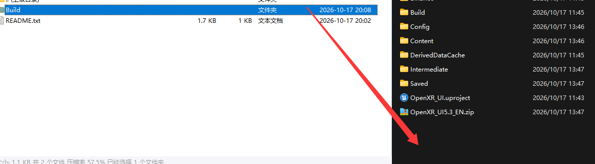

<!-- DOCBLOCK id="review-12" type="text" -->
<!-- ZH -->
本次更新
<!-- EN -->
What's New
<!-- /DOCBLOCK -->

<!-- DOCBLOCK id="review-13-original" type="text" -->
<!-- ZH -->
新增：
<!-- EN -->
Added:
<!-- /DOCBLOCK -->

<!-- DOCBLOCK id="review-14" type="text" -->
<!-- ZH -->
- 适配 SteamVR 手势追踪。
- 为手势角色添加传送、旋转和抓取等基础交互。
- 添加 BPC_控件交互组件_射线，支持远距离 UI 交互与捏合点击。
<!-- EN -->
- Added support for SteamVR hand tracking.
- Added basic teleportation, turning, and grabbing interactions to the hand-tracking character.
- Added AC_WidgetInteraction_Ray for distance-based UI interaction and pinch clicks.
<!-- /DOCBLOCK -->

<!-- DOCBLOCK id="review-15" type="text" -->
<!-- ZH -->
调整：
<!-- EN -->
Updated:
<!-- /DOCBLOCK -->

<!-- DOCBLOCK id="review-15-original" type="text" -->
<!-- ZH -->
优化重置
<!-- EN -->
Improvements and Reworked Features
<!-- /DOCBLOCK -->

<!-- DOCBLOCK id="review-16" type="text" -->
<!-- ZH -->
- 优化蓝图逻辑，简化组件配置流程。
- 重置手势模型更新流程，可通过对应节点切换手势数据资产，更新手势模型。
- 重置滚动框交互逻辑，恢复通过模拟鼠标右键拖拽滚动框的方式进行滚动。
<!-- EN -->
- Optimized Blueprint logic and simplified component setup.
- Reworked the hand model update flow. Use the corresponding node to switch the gesture data asset and update the hand model.
- Reworked Scroll Box interaction to restore scrolling by simulating a right mouse button drag.
<!-- /DOCBLOCK -->

<!-- DOCBLOCK id="review-18" type="text" -->
<!-- ZH -->
开始前的检查
<!-- EN -->
Before You Begin
<!-- /DOCBLOCK -->

<!-- DOCBLOCK id="review-19" type="text" -->
<!-- ZH -->
1. 确认 VR 开发环境可用：已开启设备开发者权限，可以正常串流或运行 VR 项目，并能够识别手部追踪。
2. 项目必须启用 OpenXR 和 OpenXRHandTracking。缺少依赖插件时，相关蓝图可能报错。
3. 手势追踪效果受设备、环境及硬件能力影响。排查识别问题时，应先确认设备本身能稳定输出手部追踪数据。
<!-- EN -->
1. Verify that your VR development environment works: enable developer permissions on the device, confirm that VR streaming or standalone VR applications run correctly, and check that hand tracking is recognized.
2. Enable OpenXR and OpenXRHandTracking in the project. Missing dependencies may cause errors in the related Blueprints.
3. Hand tracking depends on the device, environment, and hardware capabilities. When troubleshooting recognition issues, first confirm that the device provides stable hand-tracking data.
<!-- /DOCBLOCK -->

<!-- DOCBLOCK id="review-20" type="text" -->
<!-- ZH -->
前置条件视频：
<!-- EN -->
Prerequisites Video:
<!-- /DOCBLOCK -->

<!-- DOCBLOCK id="review-20-original" type="text" -->
<!-- ZH -->
使用此项目前置条件视频（最新版本待更新）
<!-- EN -->
Video: Prerequisites for Using This Project
<!-- /DOCBLOCK -->

<!-- DOCBLOCK id="review-21" type="text" -->
<!-- ZH -->
https://www.youtube.com/watch?v=pUs-mc1Vdtw
<!-- EN -->
https://www.youtube.com/watch?v=pUs-mc1Vdtw
<!-- /DOCBLOCK -->

<!-- DOCBLOCK id="review-22" type="text" -->
<!-- ZH -->
更换手势模型
<!-- EN -->
Changing the Hand Model
<!-- /DOCBLOCK -->

<!-- DOCBLOCK id="review-23" type="text" -->
<!-- ZH -->
1. 准备与 OpenXR 手部骨骼结构相适配的模型，检查骨骼名称、层级及旋转轴向。
2. 如需双手 UI 交互，准备左右手模型，并分别设置对应的手势数据资产。
3. 在 PAD_手势配置 中填写骨骼映射，设置位置偏移、整体旋转及骨骼旋转校准。
<!-- EN -->
1. Prepare a model compatible with the OpenXR hand skeleton. Check bone names, hierarchy, and rotation axes.
2. For UI interaction with both hands, prepare left- and right-hand models and assign the corresponding gesture data assets separately.
3. In PAD_GestureConfig, configure XRGestureToCustomBoneMap, GestureRelativeOffset, GestureRelativeRotation, and GestureBoneRotationCalibration.
<!-- /DOCBLOCK -->

<!-- DOCBLOCK id="review-24" type="text" -->
<!-- ZH -->
原文列出的测试设备为 Quest 3、PICO 4 Pro；PC 串流平台为 Meta Horizon Link、SteamVR、PICO 互联。
<!-- EN -->
The original documentation lists Quest 3 and PICO 4 Pro as test devices, with Meta Horizon Link, SteamVR, and PICO Connect used for PC streaming.
<!-- /DOCBLOCK -->

<!-- DOCBLOCK id="review-25" type="text" -->
<!-- ZH -->
Quest 注意事项
<!-- EN -->
Quest Notes
<!-- /DOCBLOCK -->

<!-- DOCBLOCK id="review-26" type="text" -->
<!-- ZH -->
原文记录：UE 5.6 之前的版本在 Quest 安卓打包后，出现手势无效的情况。
<!-- EN -->
Recorded behavior: hand tracking did not work in Quest Android builds made with UE versions earlier than 5.6.
<!-- /DOCBLOCK -->

<!-- DOCBLOCK id="review-27" type="text" -->
<!-- ZH -->
原有处理方法一：下载补充文件的 ZIP 压缩包，将其中的 Build 文件夹解压到项目根目录，再重新打包。
https://drive.google.com/drive/folders/1sM8ENQs16vU-sUkuhrR8MW-gbacvxulv?usp=drive_link
<!-- EN -->
Original workaround 1: download the supplementary ZIP archive, extract its Build folder into the project root, and package the project again.
https://drive.google.com/drive/folders/1sM8ENQs16vU-sUkuhrR8MW-gbacvxulv?usp=drive_link
<!-- /DOCBLOCK -->

<!-- DOCBLOCK id="review-image-p1769101542580-pmvcctrhp0jpzwo9" type="image" -->

<!-- /DOCBLOCK -->

<!-- DOCBLOCK id="review-30" type="text" -->
<!-- ZH -->
原有处理方法二：启用 MetaXR，并在项目设置中检查以下配置：
<!-- EN -->
Original workaround 2: enable MetaXR and check the following options in Project Settings:
<!-- /DOCBLOCK -->

<!-- DOCBLOCK id="review-31" type="text" -->
<!-- ZH -->
1. XR API：Epic Native OpenXR with Oculus vendor extensions。
2. Hand Tracking Support：Controllers and Hands。
<!-- EN -->
1. XR API: Epic Native OpenXR with Oculus vendor extensions.
2. Hand Tracking Support: Controllers and Hands.
<!-- /DOCBLOCK -->

<!-- DOCBLOCK id="review-32" type="text" -->
<!-- ZH -->
MetaXR 下载：
<!-- EN -->
Download MetaXR:
<!-- /DOCBLOCK -->

<!-- DOCBLOCK id="review-33" type="text" -->
<!-- ZH -->
https://developers.meta.com/horizon/downloads/package/unreal-engine-5-integration/
<!-- EN -->
https://developers.meta.com/horizon/downloads/package/unreal-engine-5-integration/
<!-- /DOCBLOCK -->

<!-- DOCBLOCK id="review-image-p1769101542580-b1769773154230" type="image" -->

<!-- /DOCBLOCK -->

<!-- DOCBLOCK id="review-35" type="text" -->
<!-- ZH -->
PICO 注意事项
<!-- EN -->
PICO Notes
<!-- /DOCBLOCK -->

<!-- DOCBLOCK id="review-36" type="text" -->
<!-- ZH -->
1. 原文记录：在 UE 5.7 中，PICO 安卓包可能在一体机启动时闪退；原文同时说明官方示例也曾出现同类现象。
2. PICO 安卓打包需要配合PICO OpenXR或者PICO XR 插件。
<!-- EN -->
1. Recorded behavior: PICO Android builds in UE 5.7 may crash at startup on the standalone headset. The original documentation reports the same behavior in the official sample.
2. PICO Android packaging requires the PICO OpenXR or PICO XR plugin.
<!-- /DOCBLOCK -->

<!-- DOCBLOCK id="review-36-part-4" type="text" -->
<!-- ZH -->
3. 原文记录：UE 5.5 下，PICO 插件可能导致控件交互 UI 异常，当时暂无解决方法。
<!-- EN -->
3. Recorded behavior: the PICO plugin may cause incorrect widget UI interaction in UE 5.5. No workaround was available at the time of writing.
<!-- /DOCBLOCK -->

<!-- DOCBLOCK id="review-36-part-6" type="text" -->
<!-- ZH -->
4. 原文要求替换绑定 PICO 的输入文件。IMC_Default_PICO，IMC_Hands_PICO
<!-- EN -->
4. Replace the PICO input bindings with IMC_Default_PICO and IMC_Hands_PICO, as specified in the original documentation.
<!-- /DOCBLOCK -->
