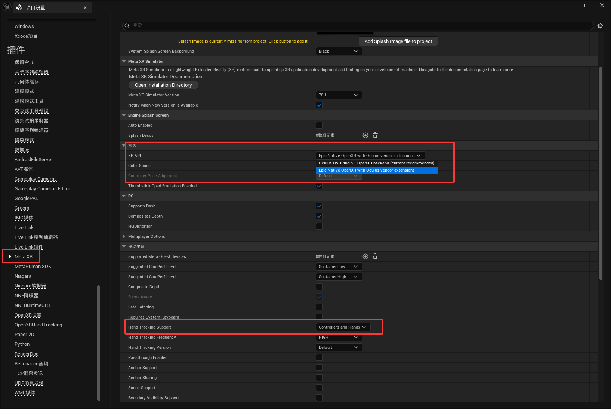
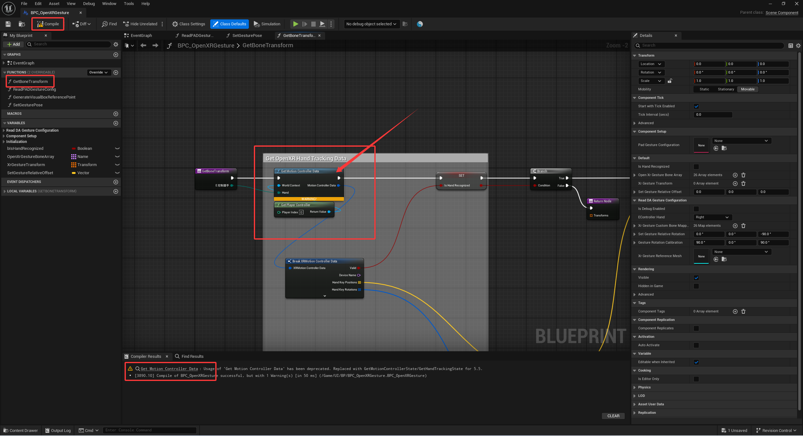

<!-- DOCBLOCK id="b1769102094154" type="text" -->
<!-- ZH -->
更新说明
<!-- EN -->
Prerequisites
<!-- /DOCBLOCK -->

<!-- DOCBLOCK id="pmvb3elmhpg2u270" type="text" -->
<!-- ZH -->
新增
1.适配SteamVR手势追踪
2.添加手势角色基础交互：传送移动，旋转，抓取功能
3.新增控件交互组件_射线
常规的远程UI交互，捏合点击UI触发交互
优化重置
1.优化蓝图逻辑，简化配置流程。
2.重置手势模型更新功能，现在只需要调用对应节点，切换对应手势数据资产即可切换手势模型，而不是之前通过切换玩家Pawn。
3.重置滚动框逻辑，变回模拟鼠标右键拖拽滚动框
<!-- EN -->

<!-- /DOCBLOCK -->

<!-- DOCBLOCK id="pmvb3e8xajlphza4" type="text" -->
<!-- ZH -->
前置条件
<!-- EN -->

<!-- /DOCBLOCK -->

<!-- DOCBLOCK id="b1770631134935" type="text" -->
<!-- ZH -->
使用此项目前置条件视频
https://www.youtube.com/watch?v=pUs-mc1Vdtw
<!-- EN -->
Prerequisite Video for using this project:
https://www.youtube.com/watch?v=pUs-mc1Vdtw
<!-- /DOCBLOCK -->

<!-- DOCBLOCK id="b1770630818555" type="text" -->
<!-- ZH -->

<!-- EN -->
PC Streaming Instructions
<!-- /DOCBLOCK -->

<!-- DOCBLOCK id="b1770630924744" type="text" -->
<!-- ZH -->
开发环境说明
手势追踪识别的精度与设备等硬件设备有关，与项目功能无关。
<!-- EN -->
Development Environment Notes
<!-- /DOCBLOCK -->

<!-- DOCBLOCK id="b1769101719820" type="text" -->
<!-- ZH -->
1.确保你有正常的VR开发环境，开发者权限/虚幻引擎VR串流/手势能正常工作。
<!-- EN -->
1. Ensure you have a functioning VR development environment, developer permissions, Unreal Engine VR Streaming/Link setup, and that hand tracking/gestures are working correctly.
<!-- /DOCBLOCK -->

<!-- DOCBLOCK id="b1791986912346" type="text" -->
<!-- ZH -->

<!-- EN -->
...
<!-- /DOCBLOCK -->

<!-- DOCBLOCK id="b1770631382759" type="text" -->
<!-- ZH -->
2.此项目必须开启Openxr和OpenXRHandTracking，缺少插件蓝图会报错！
<!-- EN -->
2. This project must have OpenXR and OpenXRHandTracking enabled. Blueprints will throw an error if these plugins are missing.
<!-- /DOCBLOCK -->

<!-- DOCBLOCK id="b1769101784227" type="text" -->
<!-- ZH -->
3.测试平台Quest3/Pico4pro,打包Demo版本为5.6
<!-- EN -->
3.Supports UE 5.3 - 5.7, tested platforms Quest 3 / Pico 4 Pro, packaged demo version is 5.6.
<!-- /DOCBLOCK -->

<!-- DOCBLOCK id="b1770631522831" type="text" -->
<!-- ZH -->
更换手势模型
<!-- EN -->
Gesture Model
<!-- /DOCBLOCK -->

<!-- DOCBLOCK id="b1769102137437" type="text" -->
<!-- ZH -->
1.手势模型需要与openxr骨骼相近的模型，并且骨骼坐标旋转统一
2.需要准备两只手的模型（如何你需要双手UI交互）
PC串流平台
Meta Horizon Link
SteamVR
PICO 互联
<!-- EN -->
1. The gesture model needs to be close to the OpenXR skeleton model, including bone coordinates and rotation.
2. Two hand models are required (if you need two-hand UI interaction).
<!-- /DOCBLOCK -->

<!-- DOCBLOCK id="b1769102318681" type="text" -->
<!-- ZH -->

<!-- EN -->
Project Version Differences / Fixes
<!-- /DOCBLOCK -->

<!-- DOCBLOCK id="b1769772192795" type="text" -->
<!-- ZH -->
Quest须知
<!-- EN -->
Quest Notes
<!-- /DOCBLOCK -->

<!-- DOCBLOCK id="b1769772212293" type="text" -->
<!-- ZH -->
UE5.6之前版本Quest打包安卓手势无效

解决方法：

1.Quest需要开启metaxr，项目设置找到metaxr

2.XR API选用Epic Native OpenXR with Oculus vendor extensions

3.Hand Tracking Support选择Controllers and Hands

MetaXR下载链接：
https://developers.meta.com/horizon/downloads/package/unreal-engine-5-integration/
<!-- EN -->
Hand gestures fail when packaging Quest for Android in UE versions prior to 5.6.

Solution:

1. MetaXR must be enabled for Quest. Locate MetaXR in Project Settings.

2. Select "Epic Native OpenXR with Oculus vendor extensions" for the XR API.

3. Set Hand Tracking Support to "Controllers and Hands."

MetaXR Download Link:
https://developers.meta.com/horizon/downloads/package/unreal-engine-5-integration/
<!-- /DOCBLOCK -->

<!-- DOCBLOCK id="b1769773154230" type="image" -->

<!-- /DOCBLOCK -->

<!-- DOCBLOCK id="b1769101967375" type="text" -->
<!-- ZH -->
PICO须知
<!-- EN -->
PICO Notice
<!-- /DOCBLOCK -->

<!-- DOCBLOCK id="b1769101929413" type="text" -->
<!-- ZH -->
1.PICO安卓打包5.7，一体机运行闪退。与本项目无关，即使打包pico官方示例依然会出现这个问题。（截止文档日期2026.1.23）
<!-- EN -->
1.PICO Android packaging using version 5.7 results in a crash upon launch on the standalone headset. This is unrelated to the current project, as the issue still occurs even when packaging the official PICO sample project. (As of 2026.1.23)
<!-- /DOCBLOCK -->

<!-- DOCBLOCK id="b1769102970651" type="text" -->
<!-- ZH -->

<!-- EN -->
2. BP_Controller Character (5.7 Error)
UE5.7 VR template modifications and folder/Blueprint name changes have resulted in the loss of the character index from pre-5.7 versions.
Therefore, 5.7 requires the XRPawn to be reconfigured. "2. Quick Configuration" will provide detailed instructions on how to set up the new character.
<!-- /DOCBLOCK -->

<!-- DOCBLOCK id="b1769102275493" type="text" -->
<!-- ZH -->
2.Pico安卓打包需要picoopenxr/picoxr插件
<!-- EN -->
2.Pico Android packaging requires the picoopenxr/picoxr plugin.
<!-- /DOCBLOCK -->

<!-- DOCBLOCK id="b1769860394222" type="text" -->
<!-- ZH -->
3.UE5.5一体机安卓测试，控件交互UI异常，与pico插件BUG有关（暂无解决方法）
<!-- EN -->
3. UE 5.5 Standalone Android Test: Abnormal Widget Interaction UI due to Pico plugin bug (No current solution).
<!-- /DOCBLOCK -->

<!-- DOCBLOCK id="b1769103626628" type="text" -->
<!-- ZH -->
4.pico默认手势骨骼与openxr手势骨骼存在偏移，需要手动矫正（已配置对应的数据资产）

项目版本差异/修复
<!-- EN -->
4. The default Pico hand skeleton is misaligned with the OpenXR hand skeleton, requiring manual correction (the corresponding Data Asset has been configured)
<!-- /DOCBLOCK -->

<!-- DOCBLOCK id="b1769102332387" type="text" -->
<!-- ZH -->
由于虚幻引擎VR模板版本更迭的原因，VR模板变更，节点被弃用，若你使用低版本：5.3→5.7需要手动修复。在 2.快速配置 中会详细教学如何修复！
<!-- EN -->
Due to the version iteration of the Unreal Engine VR Template, the VR Template has changed, and nodes have been deprecated. If you are using a lower version: 5.3 -> 5.7, manual repair is required. The detailed instructions on how to repair will be provided in the 2. Quick Configuration section!
<!-- /DOCBLOCK -->

<!-- DOCBLOCK id="b1769102693857" type="text" -->
<!-- ZH -->
1.BPC_OpenXR手势
GetMotionControllerData节点，5.5之后变更，5.7被弃用
需要变更为GetHandTrackingState节点
<!-- EN -->
1.BPC_OpenXRGesture
The `GetMotionControllerData` node was modified after 5.5 and deprecated in 5.7.
Requires migration/change to the `GetHandTrackingState` node.
<!-- /DOCBLOCK -->

<!-- DOCBLOCK id="a1792076102619" type="text" -->
<!-- ZH -->
...
<!-- EN -->

<!-- /DOCBLOCK -->

<!-- DOCBLOCK id="a1792076112551" type="image" -->

<!-- /DOCBLOCK -->

<!-- DOCBLOCK id="a1792076114095" type="text" -->
<!-- ZH -->
...
<!-- EN -->

<!-- /DOCBLOCK -->

<!-- DOCBLOCK id="bmv9glrhpb1xn" type="image" -->

<!-- /DOCBLOCK -->

<!-- DOCBLOCK id="pmvaulp3uyukcz4o" type="text" -->
<!-- ZH -->

<!-- EN -->

<!-- /DOCBLOCK -->

<!-- DOCBLOCK id="pmvaulp3uw59yam7" type="text" -->
<!-- ZH -->

<!-- EN -->

<!-- /DOCBLOCK -->
