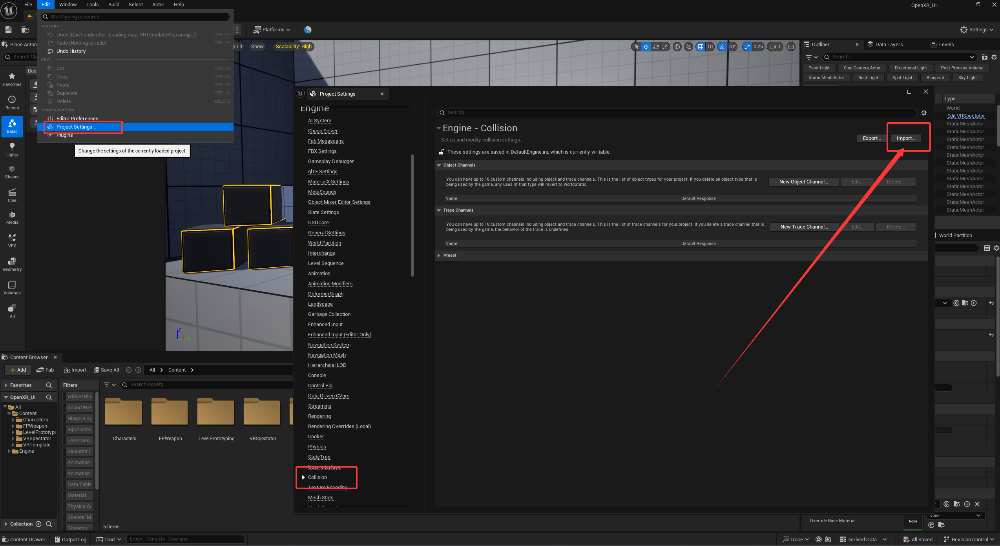
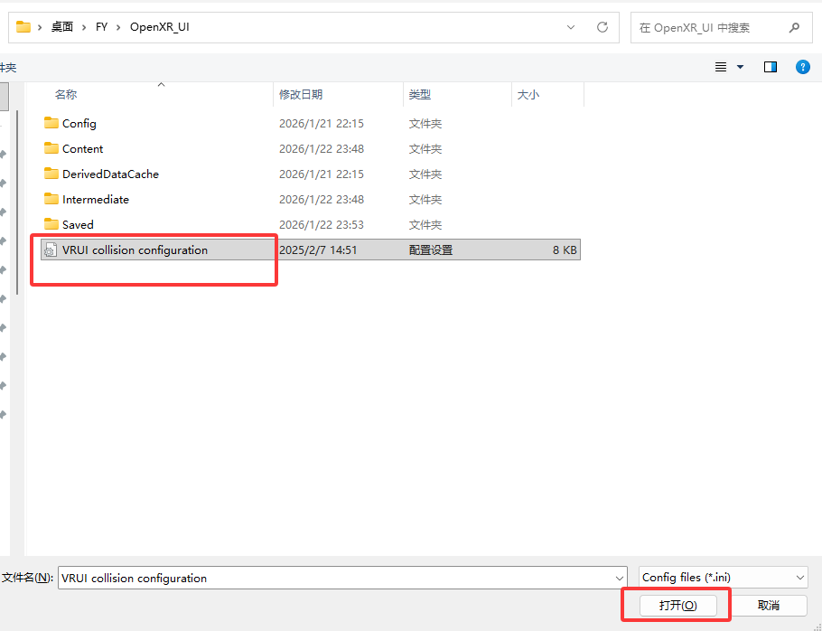

<!-- DOCBLOCK id="page-title-p1" type="text" -->
<!-- ZH -->
项目迁移须知
<!-- EN -->
Project Migration
<!-- /DOCBLOCK -->

<!-- DOCBLOCK id="review-115" type="text" -->
<!-- ZH -->
1. 准备目标 UE VR 模板项目，并导入所需资源。
2. 按原文提供的配置文件设置 VRUI 碰撞通道与响应规则。
3. 重启目标项目，确认新增检测通道出现。
4. 运行目标项目，分别检查左右手的 UI 交互和按钮响应。
碰撞预设文件
https://drive.google.com/file/d/1jaX7la-9HJ1zJZ9v6rJ5z97edTT0YeuN/view?usp=drive_link
<!-- EN -->
1. Prepare the target UE VR Template project and migrate the required assets.
2. Configure the VRUI collision channel and response rules using the configuration file provided in the original documentation.
3. Restart the target project and confirm that the new trace channel appears.
4. Run the target project and check UI interaction and button responses for both hands.
Collision preset file:
https://drive.google.com/file/d/1jaX7la-9HJ1zJZ9v6rJ5z97edTT0YeuN/view?usp=drive_link
<!-- /DOCBLOCK -->

<!-- DOCBLOCK id="review-image-p1-b1769097789400" type="image" -->

<!-- /DOCBLOCK -->

<!-- DOCBLOCK id="pmvcnfi1oup4qqix" type="text" -->
<!-- ZH -->

<!-- EN -->

<!-- /DOCBLOCK -->

<!-- DOCBLOCK id="review-image-p1-a1769861180642" type="image" -->

<!-- /DOCBLOCK -->

<!-- DOCBLOCK id="review-118" type="text" -->
<!-- ZH -->
将配置文件“导入碰撞配置”
<!-- EN -->
Import the configuration file using Import Collision Configuration.
<!-- /DOCBLOCK -->

<!-- DOCBLOCK id="pmvcm4oacri31xq3" type="image" -->

<!-- /DOCBLOCK -->

<!-- DOCBLOCK id="pmvcm4y5em6odl2t" type="text" -->
<!-- ZH -->

<!-- EN -->

<!-- /DOCBLOCK -->

<!-- DOCBLOCK id="pmvcm2gb2rspivbk" type="text" -->
<!-- ZH -->

<!-- EN -->

<!-- /DOCBLOCK -->
