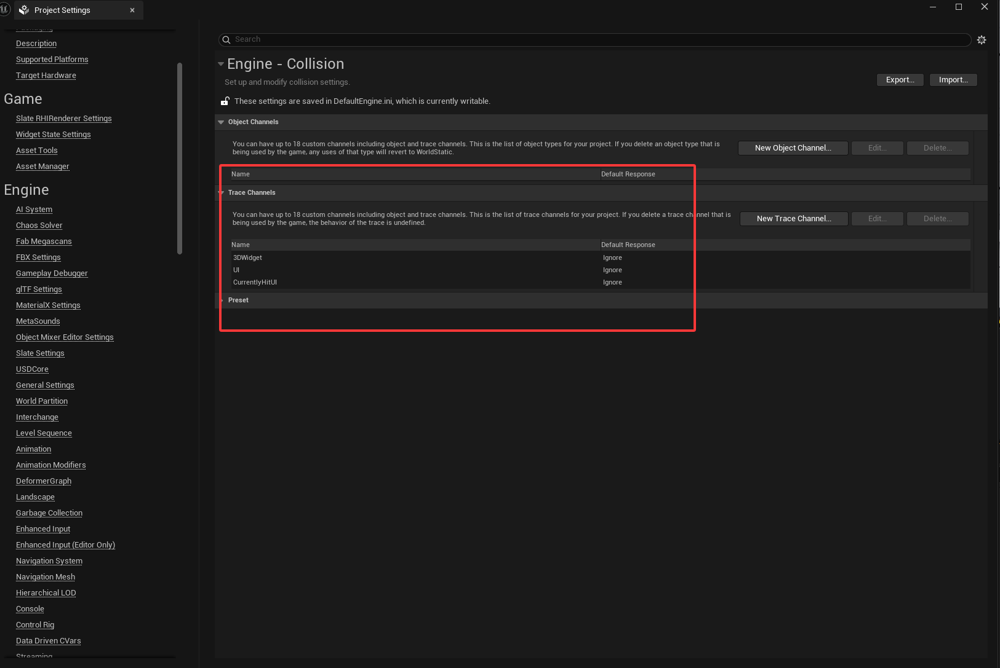

<!-- DOCBLOCK id="b1" type="text" -->
<!-- ZH -->
1.项目迁移注意事项
<!-- EN -->
Import Project
<!-- /DOCBLOCK -->

<!-- DOCBLOCK id="b1770631228179" type="text" -->
<!-- ZH -->
由于FAB上传项目命名规范，无法单独上传碰撞预设文件，自行导出配置文件，可以在这里下载：
https://drive.google.com/file/d/1jaX7la-9HJ1zJZ9v6rJ5z97edTT0YeuN/view?usp=drive_link
<!-- EN -->
Due to the FAB project naming convention for uploads, the collision preset file cannot be uploaded separately and can be downloaded here:
https://drive.google.com/file/d/1jaX7la-9HJ1zJZ9v6rJ5z97edTT0YeuN/view?usp=drive_link
<!-- /DOCBLOCK -->

<!-- DOCBLOCK id="b1769097870950" type="text" -->
<!-- ZH -->
新建UE5VR模板项目，打开压缩包将VRUI碰撞配置文件复制到新建的项目文件夹
<!-- EN -->
Create a new UE5 VR Template Project. Open the archive and copy the VR UI Collision Configuration File into the new project folder.
<!-- /DOCBLOCK -->

<!-- DOCBLOCK id="b1769097976247" type="text" -->
<!-- ZH -->

<!-- EN -->
Open the Content folder of the archive, and copy the UI folder into the Content directory of your new project.
<!-- /DOCBLOCK -->

<!-- DOCBLOCK id="b1769015850260" type="text" -->
<!-- ZH -->

<!-- EN -->
Open Project Settings, find the Collision option, import the VRUI Collision Configuration
<!-- /DOCBLOCK -->

<!-- DOCBLOCK id="b1769097789400" type="image" -->

<!-- /DOCBLOCK -->

<!-- DOCBLOCK id="b1769098258075" type="text" -->
<!-- ZH -->
导入VRUI碰撞配置文件重启项目，重启完成会看到新增的检测通道
<!-- EN -->
Import the VRUI collision profile and restart the project. Once restarted, you will see the newly added trace channel.
<!-- /DOCBLOCK -->

<!-- DOCBLOCK id="b1769098710934" type="image" -->

<!-- /DOCBLOCK -->

<!-- DOCBLOCK id="pmvaulylw397l0bg" type="text" -->
<!-- ZH -->

<!-- EN -->

<!-- /DOCBLOCK -->
