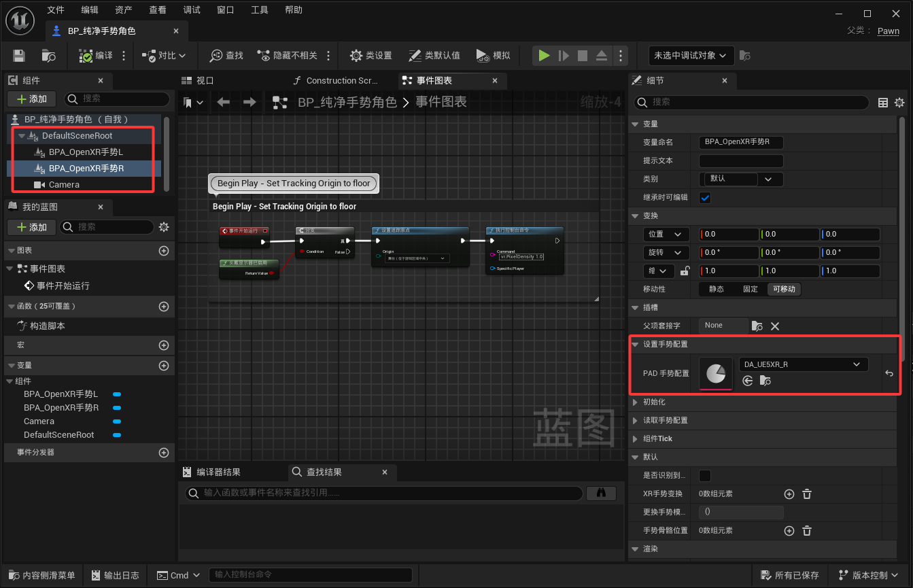
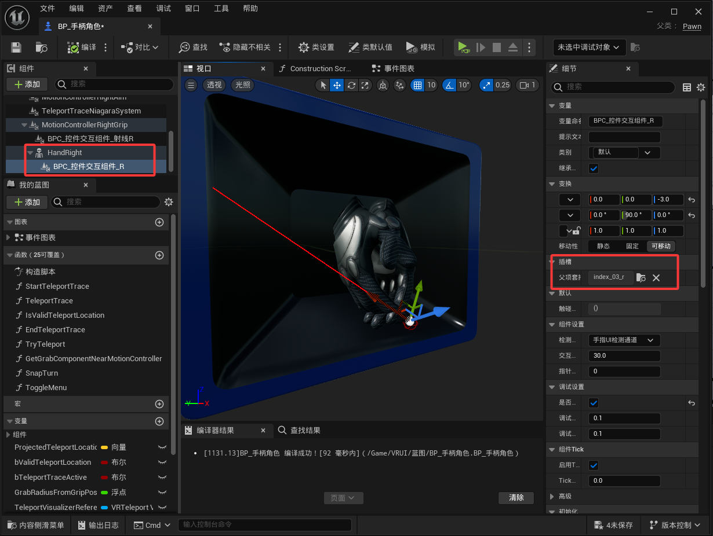
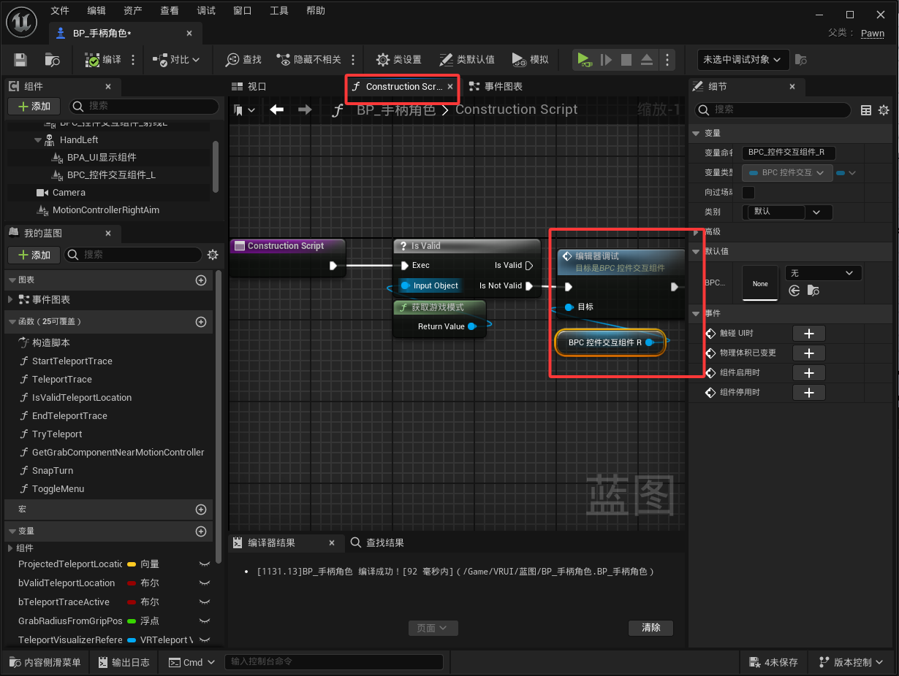
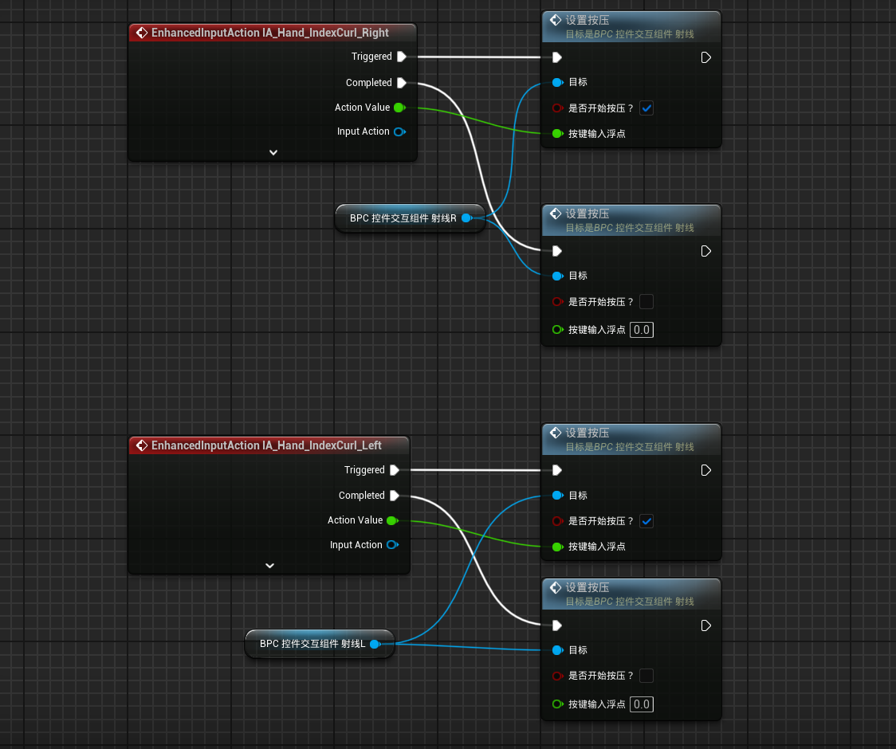
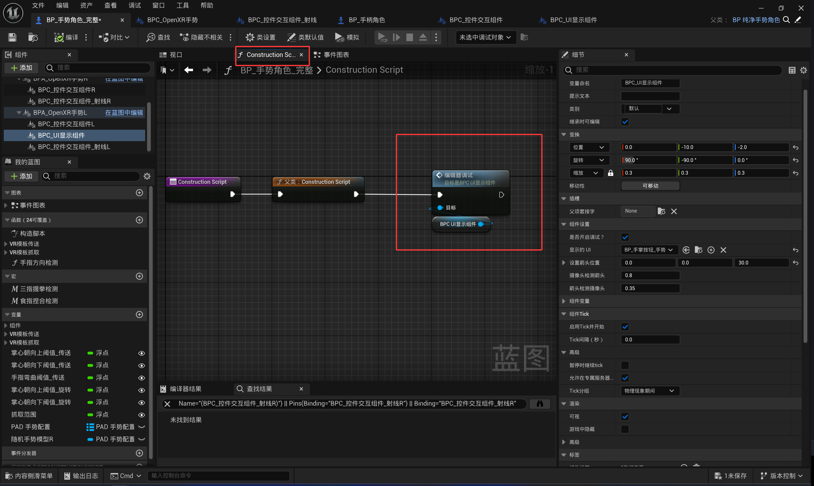

<!-- DOCBLOCK id="page-title-p1792150504802" type="text" -->
<!-- ZH -->
配置流程
<!-- EN -->
Setup
<!-- /DOCBLOCK -->

<!-- DOCBLOCK id="pmvcndzzpbq9uasc" type="text" -->
<!-- ZH -->
简化手势配置流程
添加一个 BPC_OpenXR手势 组件，并为需要的左右手分配对应的手势数据资产。
<!-- EN -->
Simplified hand-tracking setup
Add AC_OpenXRGesture and assign the corresponding gesture data asset for each hand you use.
<!-- /DOCBLOCK -->

<!-- DOCBLOCK id="review-40" type="text" -->
<!-- ZH -->
配置 BPC_控件交互组件
<!-- EN -->
Setting Up AC_WidgetInteraction
<!-- /DOCBLOCK -->

<!-- DOCBLOCK id="review-image-p1792150504802-b1791987675801" type="image" -->

<!-- /DOCBLOCK -->

<!-- DOCBLOCK id="pmvcjr6syn44kns0" type="text" -->
<!-- ZH -->

<!-- EN -->

<!-- /DOCBLOCK -->

<!-- DOCBLOCK id="review-41-original" type="text" -->
<!-- ZH -->
手势角色：将组件添加到 BPC_OpenXR手势 下。
手柄角色：将组件添加到角色手部骨骼网格体的食指骨骼上。
<!-- EN -->
Hand-tracking character: attach the component to AC_OpenXRGesture.
Controller character: attach the component to the index-finger bone of the character’s hand Skeletal Mesh.
<!-- /DOCBLOCK -->

<!-- DOCBLOCK id="review-image-p1792150504802-pmvbnn04ad3hdi63" type="image" -->

<!-- /DOCBLOCK -->

<!-- DOCBLOCK id="review-42" type="text" -->
<!-- ZH -->
如需在蓝图视口预览，在构造脚本中调用组件对应的 编辑器调试 节点，并开启细节面板中的调试设置。
<!-- EN -->
To preview the component in the Blueprint viewport, call its OnEditorDebug node in the Construction Script and enable the debug options in the Details panel.
<!-- /DOCBLOCK -->

<!-- DOCBLOCK id="review-image-p1792150504802-pmvbnoo80qphjb0d" type="image" -->

<!-- /DOCBLOCK -->

<!-- DOCBLOCK id="pmvck817myln66d6" type="text" -->
<!-- ZH -->

<!-- EN -->

<!-- /DOCBLOCK -->

<!-- DOCBLOCK id="review-43" type="text" -->
<!-- ZH -->
配置 BPC_控件交互组件_射线
<!-- EN -->
Setting Up AC_WidgetInteraction_Ray
<!-- /DOCBLOCK -->

<!-- DOCBLOCK id="review-44" type="text" -->
<!-- ZH -->
- 手势角色：将组件添加到 BPC_OpenXR手势 下。
- 手柄角色：将组件添加到 运动控制器组件 下。
<!-- EN -->
- Hand-tracking character: attach the component to AC_OpenXRGesture.
- Controller character: attach the component to the Motion Controller Component.
<!-- /DOCBLOCK -->

<!-- DOCBLOCK id="review-45-original" type="text" -->
<!-- ZH -->
为 BPC_控件交互组件_射线 绑定输入并调用「设置按压」。用布尔值控制模拟鼠标左键的按下和松开。
<!-- EN -->
Bind an input to AC_WidgetInteraction_Ray and call OnSetPress. Use a Boolean to control when the simulated left mouse button is pressed or released.
<!-- /DOCBLOCK -->

<!-- DOCBLOCK id="review-image-p1792150504802-pmvb0tv6x69uso4n" type="image" -->

<!-- /DOCBLOCK -->

<!-- DOCBLOCK id="pmvck8udjhgxbj6q" type="text" -->
<!-- ZH -->

<!-- EN -->

<!-- /DOCBLOCK -->

<!-- DOCBLOCK id="review-46" type="text" -->
<!-- ZH -->
配置 BPC_UI显示组件
<!-- EN -->
Setting Up AC_UIDisplay
<!-- /DOCBLOCK -->

<!-- DOCBLOCK id="review-47-original" type="text" -->
<!-- ZH -->
指定包含要显示的 UI 的 Actor 类。
在构造脚本中调用 BPC_UI显示组件 的「编辑器调试」节点，可在编辑器中预览放置位置。手势模式下的位置以运行时预览为准。
设置检测箭头的位置，通常放在掌心附近。视线朝向箭头并满足检测条件时，UI 才会显示。
<!-- EN -->
Assign the Actor class that contains the UI you want to display.
Call OnEditorDebug on AC_UIDisplay in the Construction Script to preview its placement. For hand tracking, check the final placement at runtime.
Position the detection arrow, usually near the palm. The UI appears when the viewer looks toward the arrow and the detection conditions are met.
<!-- /DOCBLOCK -->

<!-- DOCBLOCK id="review-image-p1792150504802-pmvb0gwgs1282nbp" type="image" -->

<!-- /DOCBLOCK -->

<!-- DOCBLOCK id="pmvcjr28x8j15koi" type="text" -->
<!-- ZH -->

<!-- EN -->

<!-- /DOCBLOCK -->
