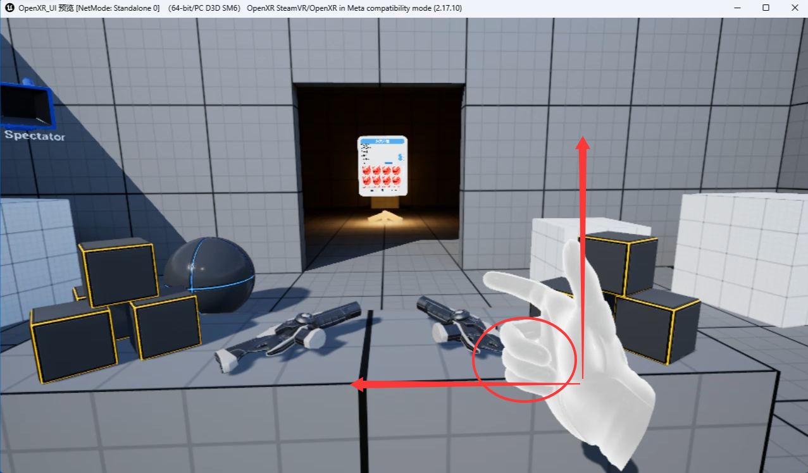
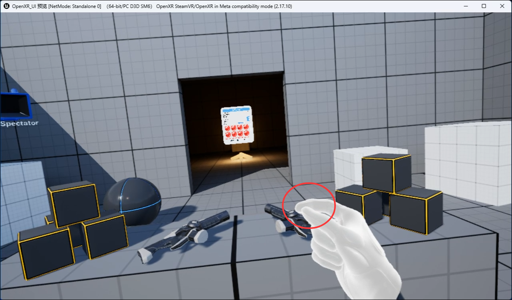
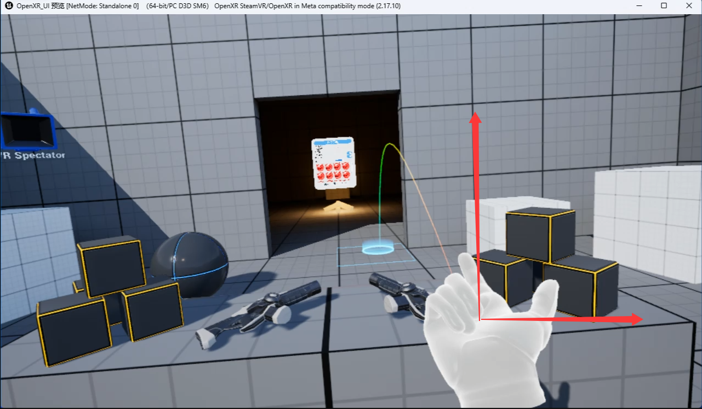

<!-- DOCBLOCK id="page-title-p1792160531812" type="text" -->
<!-- ZH -->
手势角色基础操作
<!-- EN -->
Basic Hand-Tracking Controls
<!-- /DOCBLOCK -->

<!-- DOCBLOCK id="review-49" type="text" -->
<!-- ZH -->
旋转
<!-- EN -->
Turning
<!-- /DOCBLOCK -->

<!-- DOCBLOCK id="review-50-original" type="text" -->
<!-- ZH -->
手势旋转
卷起中指、无名指和小指，将手掌竖直朝右。进入旋转模式后，手部模型会高亮。
<!-- EN -->
Hand-gesture turning
Curl your middle, ring, and little fingers and hold your palm vertically, facing right. The hand model highlights when turning mode is active.
<!-- /DOCBLOCK -->

<!-- DOCBLOCK id="review-image-p1792160531812-pmvb2p0lkwozoy99" type="image" -->

<!-- /DOCBLOCK -->

<!-- DOCBLOCK id="review-51-original" type="text" -->
<!-- ZH -->
手部模型高亮时，捏合食指和拇指即可向右旋转。左手同理，可向左旋转。
<!-- EN -->
While the hand is highlighted, pinch your index finger and thumb to turn right. Use the same gesture with your left hand to turn left.
<!-- /DOCBLOCK -->

<!-- DOCBLOCK id="review-image-p1792160531812-pmvb380018l3uf37" type="image" -->

<!-- /DOCBLOCK -->

<!-- DOCBLOCK id="review-52" type="text" -->
<!-- ZH -->
传送
<!-- EN -->
Teleportation
<!-- /DOCBLOCK -->

<!-- DOCBLOCK id="review-53-original" type="text" -->
<!-- ZH -->
手势传送
将右手掌心朝上，卷起中指、无名指和小指。进入传送模式时手部模型会高亮，捏合食指和拇指即可触发传送。
<!-- EN -->
Hand-gesture teleportation
With your right palm facing up, curl your middle, ring, and little fingers. The hand model highlights when teleport mode is active. Pinch your index finger and thumb to teleport.
<!-- /DOCBLOCK -->

<!-- DOCBLOCK id="review-image-p1792160531812-pmvb39wdku67m2nc" type="image" -->

<!-- /DOCBLOCK -->

<!-- DOCBLOCK id="review-55" type="text" -->
<!-- ZH -->
抓取
<!-- EN -->
Grabbing
<!-- /DOCBLOCK -->

<!-- DOCBLOCK id="review-56-original" type="text" -->
<!-- ZH -->
抓取物体时，同样使用食指和拇指的捏合手势。
<!-- EN -->
Use the same index-finger and thumb pinch to grab objects.
<!-- /DOCBLOCK -->
