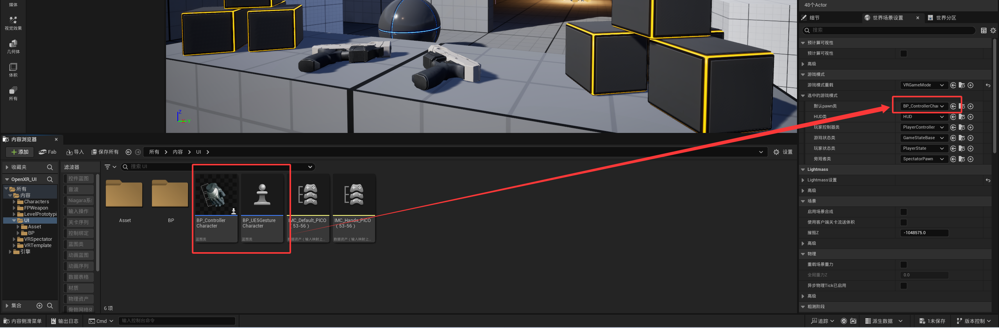
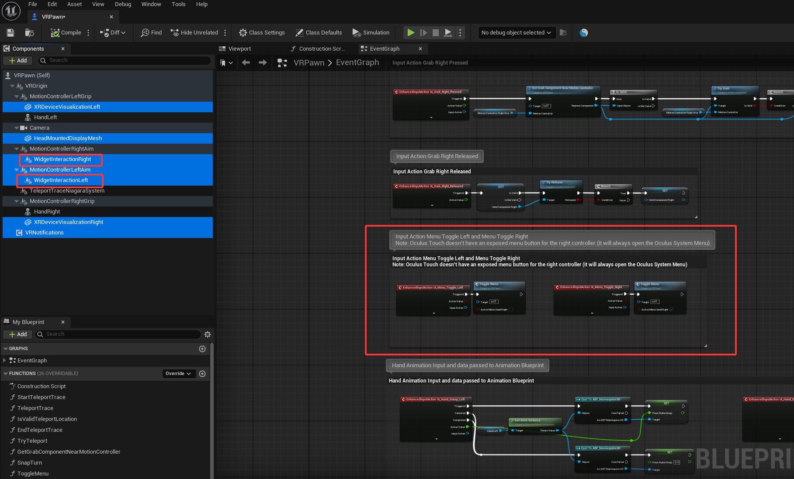
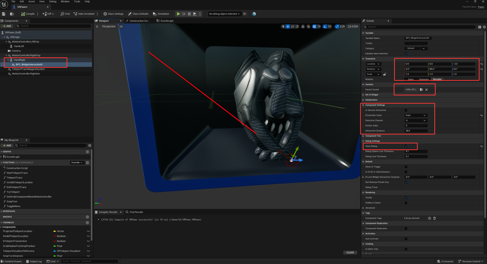
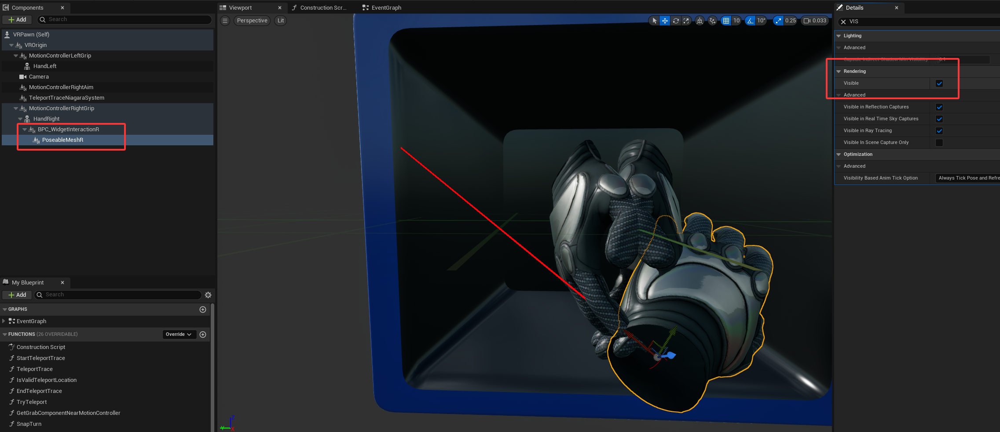
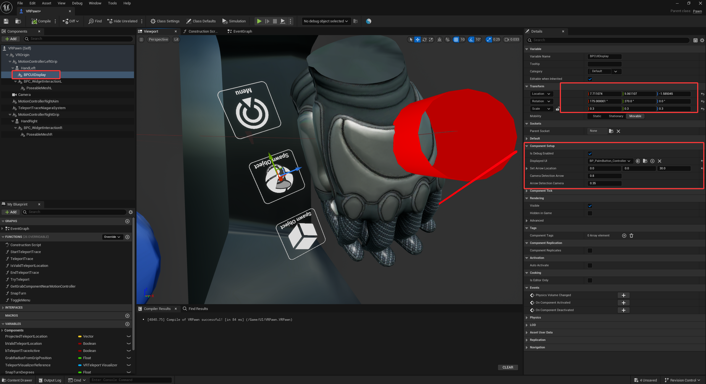
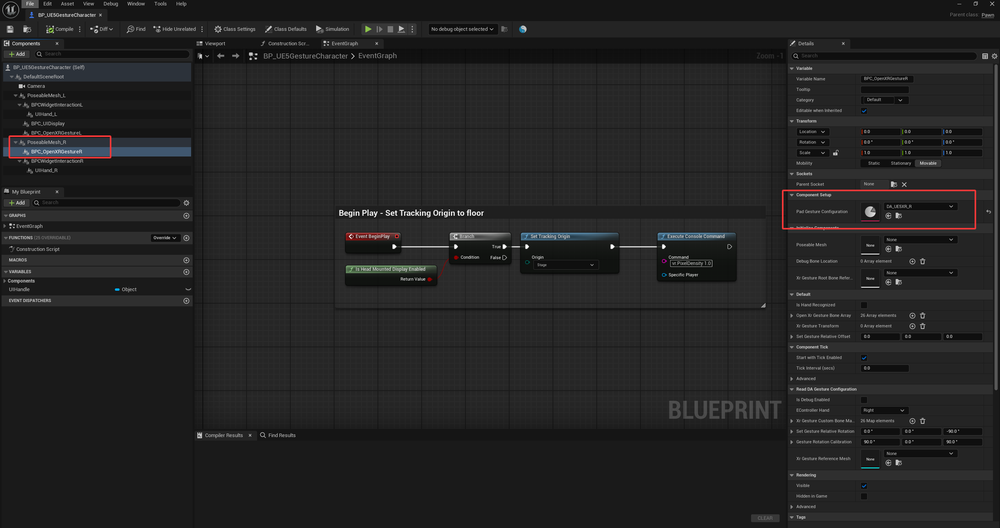
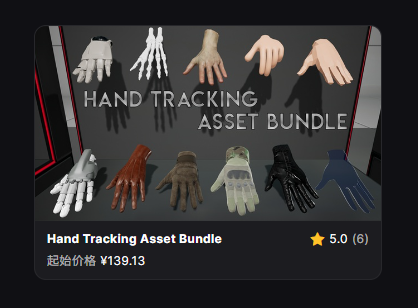

<!-- DOCBLOCK id="b1769101324105" type="text" -->
<!-- ZH -->
功能验证
<!-- EN -->
Functionality Verification
<!-- /DOCBLOCK -->

<!-- DOCBLOCK id="b1769101324860" type="text" -->
<!-- ZH -->
完成1.导入项目之后
更换手柄/手势角色验证是否正常运行
<!-- EN -->
After completing step 1 (Project Import), switch the controller/gesture character to verify proper operation.
<!-- /DOCBLOCK -->

<!-- DOCBLOCK id="b1769101422823" type="image" -->

<!-- /DOCBLOCK -->

<!-- DOCBLOCK id="b1769110697908" type="text" -->
<!-- ZH -->
修复节点
<!-- EN -->
Fix Node
<!-- /DOCBLOCK -->

<!-- DOCBLOCK id="b1769110856334" type="text" -->
<!-- ZH -->
如果你使用低版本的项目5.3导入高版本例如5.5/5.7，BPC_OpenXR手势会报错，5.3的节点被启用
<!-- EN -->
If you import a low-version project, such as 5.3, into a higher version, such as 5.5/5.7, the BPC_OpenXR Gestures will report an error, and the 5.3 nodes will be enabled.
<!-- /DOCBLOCK -->

<!-- DOCBLOCK id="b1769110669099" type="image" -->

<!-- /DOCBLOCK -->

<!-- DOCBLOCK id="b1769111147376" type="text" -->
<!-- ZH -->
我们使用GetHand TrackingState节点，重新连接修复报错的引脚
<!-- EN -->
We use the GetHand TrackingState node to reconnect the pins and fix the error.
<!-- /DOCBLOCK -->

<!-- DOCBLOCK id="b1769111406051" type="image" -->

<!-- /DOCBLOCK -->

<!-- DOCBLOCK id="b1769111480132" type="text" -->
<!-- ZH -->
配置VR手柄角色
<!-- EN -->
Configure VR Controller Character
<!-- /DOCBLOCK -->

<!-- DOCBLOCK id="b1769113229920" type="text" -->
<!-- ZH -->
新建/复制VR模板角色
<!-- EN -->
Create/Duplicate VR Template Character
<!-- /DOCBLOCK -->

<!-- DOCBLOCK id="b1769111571536" type="text" -->
<!-- ZH -->
新建/复制你对应UE版本VR模板的角色，删除图中选中用不到的组件，最好删除按钮菜单
注意：特别是WidgetInteraction，它会影响该项目的控件交互组件！
<!-- EN -->
Create/Copy the character from the VR template corresponding to your UE version. Delete the selected unused components (shown in the image), and ideally, the button menu. Note: Especially the WidgetInteraction component, as it will affect this project's widget interaction components!
<!-- /DOCBLOCK -->

<!-- DOCBLOCK id="b1769112053523" type="image" -->

<!-- /DOCBLOCK -->

<!-- DOCBLOCK id="b1769113202817" type="text" -->
<!-- ZH -->
添加BPC_控件交互组件
<!-- EN -->
Add BPC_WidgetInteraction
<!-- /DOCBLOCK -->

<!-- DOCBLOCK id="b1769111911501" type="text" -->
<!-- ZH -->
以右手为例，在手部骨骼网格体下面添加BPC_控件交互组件
1.开启编辑器调试线条，在构造脚本里面添加编辑器调试UI蓝图接口节点，并且在调试设置里面勾选开启调试。
2.将组件附加到骨骼网格体食指骨骼
3.设置组件的位置和旋转
4.根据你的需求选择用手势/手柄
5.设置左手还是右手

<!-- EN -->
Using the right hand as an example, add the BPC_ControlInteractionComponent beneath the hand skeletal mesh.
1. Enable Editor Debug Lines, add the Editor Debug UI Blueprint Interface node in the Construction Script, and check "Enable Debugging" in the Debug settings.
2. Attach the component to the skeletal mesh index finger bone.
3. Set the component's location and rotation.
4. Select whether to use gestures or the controller/gamepad based on your requirements.
5. Set whether it is the left hand or the right hand.
<!-- /DOCBLOCK -->

<!-- DOCBLOCK id="b1769112250592" type="image" -->

<!-- /DOCBLOCK -->

<!-- DOCBLOCK id="b1769113251285" type="text" -->
<!-- ZH -->
添加PoseableMesh组件
<!-- EN -->
Add PoseableMesh Component
<!-- /DOCBLOCK -->

<!-- DOCBLOCK id="b1769112980660" type="text" -->
<!-- ZH -->
1.在BPC_控件交互组件下面添加PoseableMesh并且设置对应手部模型的骨骼网格体
2.设置PoseableMesh的可视性为否，隐藏UI手
<!-- EN -->
1. Add PoseableMesh under the BPC_WidgetInteraction and set the corresponding hand model's skeletal mesh
2. Set PoseableMesh's visibility to false, hide the UI hand
<!-- /DOCBLOCK -->

<!-- DOCBLOCK id="b1769113318494" type="text" -->
<!-- ZH -->
左手与右手设置流程一致
<!-- EN -->
The setup process for the the left hand is consistent with the right hand.
<!-- /DOCBLOCK -->

<!-- DOCBLOCK id="b1769112988024" type="image" -->

<!-- /DOCBLOCK -->

<!-- DOCBLOCK id="b1769113120549" type="text" -->
<!-- ZH -->
添加BPC_UI显示组件
<!-- EN -->
Add BPC_UIDisplay
<!-- /DOCBLOCK -->

<!-- DOCBLOCK id="b1769113313515" type="text" -->
<!-- ZH -->
在左手添加BPC_UI显示组件
1.开启编辑器调试，在构造脚本里面添加Editor Debug UI蓝图接口节点
2.添加你需要交互的UI Actor
3.设置你理想UI交互的位置
<!-- EN -->
Add the BPC_UIDisplay to the Left Hand:
1. Enable Editor Debugging, and add the Editor Debug UI Blueprint interface node within the Construction Script
2. Add the UI Actor you intend to interact with
3. Set the desired position for UI interaction
<!-- /DOCBLOCK -->

<!-- DOCBLOCK id="b1769113566263" type="image" -->

<!-- /DOCBLOCK -->

<!-- DOCBLOCK id="b1769113874001" type="text" -->
<!-- ZH -->
VR手柄角色配置完成
<!-- EN -->
VR Handheld Character Configuration Complete
<!-- /DOCBLOCK -->

<!-- DOCBLOCK id="b1769113896239" type="text" -->
<!-- ZH -->
配置VR手势角色
<!-- EN -->
Configure VR Gesture Character
<!-- /DOCBLOCK -->

<!-- DOCBLOCK id="b1769113969671" type="text" -->
<!-- ZH -->
BPC_控件交互组件/BPC_UI显示组件与手柄角色配置流程一致
<!-- EN -->
The setup process for the BPC_WidgetInteraction / BPC_UIDisplay is consistent with the Gamepad Character Configuration flow.
<!-- /DOCBLOCK -->

<!-- DOCBLOCK id="b1769114011940" type="text" -->
<!-- ZH -->
添加PoseableMesh和BPC_OpenXR手势组件
<!-- EN -->
Add PoseableMesh and BPC_OpenXRGesture
<!-- /DOCBLOCK -->

<!-- DOCBLOCK id="b1769114156899" type="text" -->
<!-- ZH -->
1.设置PoseableMesh对应的骨骼网格体模型
2.将BPC_OpenXR手势组件设置到PoseableMesh下面
3.添加BPC_OpenXR手势组件的数据资产，项目默认UE5VR模板/Quest/Pico/HTAB手部模型数据资产
<!-- EN -->
1. Set the Skeletal Mesh for the Poseable Mesh
2. Attach the BPC_OpenXRGesture under the Poseable Mesh
3. Add the BPC_OpenXRGesture Data Asset, typically the UE5VR template/Quest/Pico/HTAB hand model data asset
<!-- /DOCBLOCK -->

<!-- DOCBLOCK id="b1769114111616" type="image" -->

<!-- /DOCBLOCK -->

<!-- DOCBLOCK id="b1769114443578" type="text" -->
<!-- ZH -->
注意：该项目没有包含HTAB手部资产，按所需去FAB自行购买！
<!-- EN -->
Note: This project does not include the HTAB hand assets. Please purchase them separately from FAB as required.
<!-- /DOCBLOCK -->

<!-- DOCBLOCK id="b1769114436642" type="image" -->

<!-- /DOCBLOCK -->
