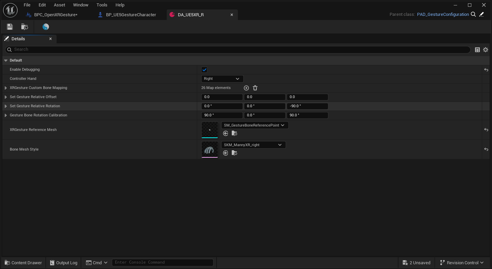

<!-- DOCBLOCK id="b1769098930999" type="text" -->
<!-- ZH -->
1.组件介绍
<!-- EN -->
1.Component Overview
<!-- /DOCBLOCK -->

<!-- DOCBLOCK id="b1769098949033" type="image" -->

<!-- /DOCBLOCK -->

<!-- DOCBLOCK id="b1769107957809" type="text" -->
<!-- ZH -->
BPC_控件交互组件
<!-- EN -->
BPC_WidgetInteraction
<!-- /DOCBLOCK -->

<!-- DOCBLOCK id="b1769108002406" type="text" -->
<!-- ZH -->
组件作用：
该组件用于与UI控件交互，命中UI切换限制到UI面板上的UI手
注意：所以，需要在该组件下面添加一个PoseableMesh UI手并且设置对应骨骼网格体，这非常重要！
<!-- EN -->
Component Function:
This component is used to interact with UI controls, managing the UI Hand that performs UI switching hits while being constrained to the UI panel.
Note:
Therefore, a PoseableMesh UI Hand must be added below this component, and the corresponding Skeletal Mesh must be set. This is very important!
<!-- /DOCBLOCK -->

<!-- DOCBLOCK id="b1769108993632" type="text" -->
<!-- ZH -->
组件设置：
1.是否为手势交互？：选择你的交互模式
2.E_控制器手：判断作用的是左手还是右手
3.检测通道：默认与UI通道的UI交互，组件命中UI时切换检测通道（当前命中的UI通道），始终至于第一次命中的UI交互，防止UI重叠的情况下，交互出现异常。
4.指针索引：控件组件的编号，用于控件区分命中的是哪种手的控件交互组件
<!-- EN -->
Component Settings:
1. Is this Gesture Interaction?: Select your interaction mode
2. E_ControllerHand: Determines whether the action originates from the left or right hand.
3. Detection Channel: Defaults to UI interaction on the UI channel. Switches the detection channel (to the currently hit UI channel) when the component hits UI. Always prioritizes the first hit UI interaction to prevent abnormal interaction when UIs overlap.
4. Pointer Index: The index number of the widget component, used by the control to distinguish which hand's control interaction component was hit.
<!-- /DOCBLOCK -->

<!-- DOCBLOCK id="b1769099005408" type="text" -->
<!-- ZH -->
BPC_OpenXR手势
<!-- EN -->
BPC_OpenXRGesture
<!-- /DOCBLOCK -->

<!-- DOCBLOCK id="b1769099062803" type="text" -->
<!-- ZH -->
组件作用：
1.UE5.6之后可以脱离MetaXR/PICOXR插件的手势组件运行手势功能。
2.用于手势追踪，基于Openxr提供的手势骨骼变换，驱动PoseableMesh。
注意：所以，该组件需要放置在PoseableMesh下面！这非常重要！
<!-- EN -->
Component Purpose:
1. After UE 5.6, hand tracking functionality can operate without needing the hand components from the MetaXR/PICOXR plugins.
2. Used for hand tracking, it drives the PoseableMesh based on the Hand Skeleton Transforms provided by OpenXR.
Note: Therefore, this component must be placed as a child component of the PoseableMesh! This is extremely important!
<!-- /DOCBLOCK -->

<!-- DOCBLOCK id="b1769104614867" type="text" -->
<!-- ZH -->
该组件通过数据资产设置对应的参数
数据资产设置：
1.是否开启调试？：
基于Openxr提供的26个手势骨骼的变换，生成26个小方块跟随对应手势骨骼，便于参考手势真实的位置。
2.E 控制器手：
用于判断当前组件驱动的是左手还是右手
3.XR手势/自定义骨骼映射：用于匹配Openxr手势骨骼和自定义手势骨骼的名称
4.设置手势相对偏移：
用于纠正手势骨骼位置注意！该参数仅在pico设备上生效，详细原因看前置条件-PICO须知
5.设置手势相对旋转：
用于矫正手势模型的整体旋转
6.手势骨骼旋转校准：
用于矫正手势骨骼的旋转轴向，手势模型所有骨骼需要轴向统一！
7.XR手势参照网格体：
用于观察Openxr手势的参考小方块模型
8.骨骼网格体样式：用于快速定位作用的手势模型文件夹位置
<!-- EN -->
This component sets corresponding parameters via a data asset.
Data Asset Settings:
1. Enable Debugging?:
Generates 26 small cubes that follow the transformations of the 26 hand tracking bones provided by OpenXR, facilitating visualization of the actual hand pose positions.
2. Controller Hand Type:
Used to determine whether the current component drives the left hand or the right hand.
3. XR Hand/Custom Bone Mapping: Used to match the names of the OpenXR hand bones and custom hand bones.
4. Set Hand Relative Offset:
Used to correct hand bone positions. Note! This parameter only takes effect on Pico devices. See Prerequisites - PICO Notes for details.
5. Set Hand Relative Rotation:
Used to correct the overall rotation of the hand model.
6. Hand Bone Rotation Calibration:
Used to correct the rotation axis orientation of the hand bones. All bones in the hand model must have consistent axis orientation!
7. XR Hand Reference Mesh:
Used to observe the reference cube model of the OpenXR hand pose.
8. Skeletal Mesh Style: Used to quickly locate the folder position of the active hand model.
<!-- /DOCBLOCK -->

<!-- DOCBLOCK id="b1769104564180" type="image" -->

<!-- /DOCBLOCK -->

<!-- DOCBLOCK id="b1769107515317" type="text" -->
<!-- ZH -->
BPC_UI显示组件
<!-- EN -->
BPC_UIDisplay
<!-- /DOCBLOCK -->

<!-- DOCBLOCK id="b1769107743088" type="text" -->
<!-- ZH -->
组件作用：
添加到手部模型，跟随手移动的UI面板，箭头检测到玩家摄像机时显示UI
<!-- EN -->
Component Purpose: A UI panel added to the hand mesh that follows hand movement. The UI is displayed when the arrow detects the Player Camera.
<!-- /DOCBLOCK -->

<!-- DOCBLOCK id="b1769109148024" type="text" -->
<!-- ZH -->
组件设置：
1.开启调试：是否显示调试_箭头
2.显示的UI:添加需要显示的UI Actor
3.设置箭头位置：设置玩家摄像头触发UI显示的位置，及箭头位置
4.摄像头/箭头检测：设置检测角度阈值，控制触发UI显示/隐藏的灵敏度
<!-- EN -->
Component Settings:
1. Enable Debugging: Whether to display the debug arrow.
2. Displayed UI: Add the UI Actor required for display.
3. Set Arrow Position: Set the location where the player camera triggers UI visibility, and the arrow position.
4. Camera/Arrow Detection: Set the detection angle threshold to control the sensitivity of triggering UI show/hide.
<!-- /DOCBLOCK -->

<!-- DOCBLOCK id="b1769107912077" type="text" -->
<!-- ZH -->
BPC_通用UI按钮
<!-- EN -->
BPC_CommonUIButton
<!-- /DOCBLOCK -->

<!-- DOCBLOCK id="b1769109050165" type="text" -->
<!-- ZH -->
组件作用：
一个可以在蓝图里面设置图标/文本/按压距离的UI按钮
<!-- EN -->
A UI button that allows the icon, text, and press distance to be configured in Blueprints.
<!-- /DOCBLOCK -->

<!-- DOCBLOCK id="b1769109503054" type="text" -->
<!-- ZH -->
组件设置：
1.按钮名称：生成按钮的名称
2.按钮图像：设置按钮的图像
3.按压距离（x轴）：按压的距离 值为0禁用按压功能，按压距离为负数-
<!-- EN -->
Component Settings:
1. Button Name: The name of the generated button
2. Button Image: Set the button image
3. Press Distance (X-axis): The distance of the press. A value of 0 disables the pressing function. A negative press distance -
<!-- /DOCBLOCK -->
