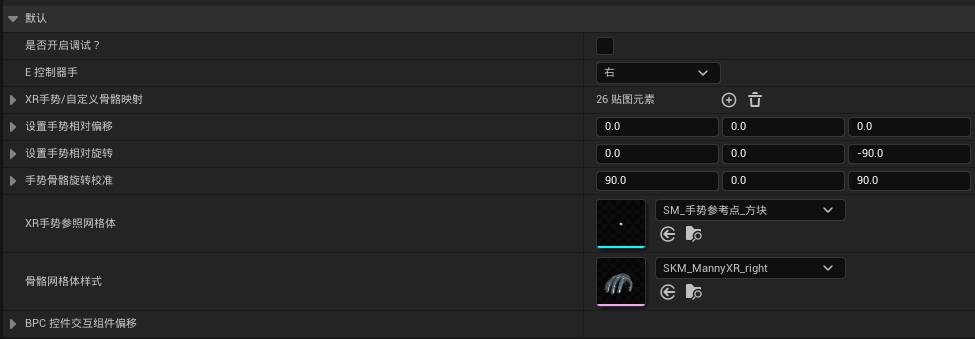

<!-- DOCBLOCK id="page-title-p1791987538788" type="text" -->
<!-- ZH -->
BPC_OpenXR手势
<!-- EN -->
AC_OpenXRGesture and PAD_GestureConfig
<!-- /DOCBLOCK -->

<!-- DOCBLOCK id="review-59" type="text" -->
<!-- ZH -->
组件自身的设置
<!-- EN -->
Component Settings
<!-- /DOCBLOCK -->

<!-- DOCBLOCK id="review-60" type="text" -->
<!-- ZH -->
PAD_手势配置：指定当前手使用的手势数据资产。手势模型、骨骼映射及相关偏移均在该数据资产中配置。
<!-- EN -->
GestureConfig: assigns the gesture data asset for the current hand. Configure the hand model, bone mapping, and related offsets in that data asset.
<!-- /DOCBLOCK -->

<!-- DOCBLOCK id="review-61" type="text" -->
<!-- ZH -->
PAD_手势配置参数
<!-- EN -->
PAD_GestureConfig Parameters
<!-- /DOCBLOCK -->

<!-- DOCBLOCK id="review-62" type="text" -->
<!-- ZH -->
是否开启调试？（布尔）
开启手部追踪调试显示，用于检查 OpenXR 手势关节参考点。
<!-- EN -->
bIsDebugEnabled (Boolean)
Enables hand-tracking debug visualization to inspect the OpenXR hand joint reference points.
<!-- /DOCBLOCK -->

<!-- DOCBLOCK id="review-63" type="text" -->
<!-- ZH -->
E 控制器手（枚举）
指定左手或右手；数据资产的选择应与组件实际用于的手一致。
<!-- EN -->
ControllerHand (Enum)
Selects the left or right hand. The data asset must match the hand that uses the component.
<!-- /DOCBLOCK -->

<!-- DOCBLOCK id="review-64" type="text" -->
<!-- ZH -->
XR手势/自定义骨骼映射（名称映射）
将 OpenXR 手势骨骼名称映射到自定义手模型的骨骼名称。按现有模板填写，检查是否漏项或拼写不一致。
<!-- EN -->
XRGestureToCustomBoneMap (Name Map)
Maps OpenXR hand bone names to the bone names of a custom hand model. Follow the existing template and check for missing entries or inconsistent spelling.
<!-- /DOCBLOCK -->

<!-- DOCBLOCK id="review-65" type="text" -->
<!-- ZH -->
设置手势相对偏移（向量）
调整手势模型的整体相对位置。
<!-- EN -->
GestureRelativeOffset (Vector)
Adjusts the overall relative position of the hand model.
<!-- /DOCBLOCK -->

<!-- DOCBLOCK id="review-66" type="text" -->
<!-- ZH -->
设置手势相对旋转（旋转）
调整手势模型的整体相对旋转。
<!-- EN -->
GestureRelativeRotation (Rotator)
Adjusts the overall relative rotation of the hand model.
<!-- /DOCBLOCK -->

<!-- DOCBLOCK id="review-67" type="text" -->
<!-- ZH -->
手势骨骼旋转校准（旋转）
调整骨骼旋转校准值，使自定义模型的骨骼轴向与手部追踪数据匹配。
<!-- EN -->
GestureBoneRotationCalibration (Rotator)
Adjusts bone rotation calibration to align the custom model's bone axes with hand-tracking data.
<!-- /DOCBLOCK -->

<!-- DOCBLOCK id="review-68" type="text" -->
<!-- ZH -->
XR手势参照网格体（静态网格体）
指定用于调试显示手势关节参考点的模型。
<!-- EN -->
XRGestureReferenceMesh (Static Mesh)
Specifies the mesh used to visualize hand joint reference points for debugging.
<!-- /DOCBLOCK -->

<!-- DOCBLOCK id="review-69" type="text" -->
<!-- ZH -->
骨骼网格体样式（骨骼网格体）
指定实际显示的手势模型。
<!-- EN -->
SkeletalMeshStyle (Skeletal Mesh)
Specifies the hand model displayed at runtime.
<!-- /DOCBLOCK -->

<!-- DOCBLOCK id="review-70" type="text" -->
<!-- ZH -->
BPC_控件交互组件偏移（变换）
设置手指控件交互组件的相对变换，包括位置、旋转和缩放；
<!-- EN -->
WidgetInteractionOffset (Transform)
Sets the relative transform of the finger's widget interaction component, including location, rotation, and scale.
<!-- /DOCBLOCK -->

<!-- DOCBLOCK id="review-image-p1791987538788-b1791987613677" type="image" -->

<!-- /DOCBLOCK -->

<!-- DOCBLOCK id="pmvclwiwd14mxvrh" type="text" -->
<!-- ZH -->

<!-- EN -->

<!-- /DOCBLOCK -->
