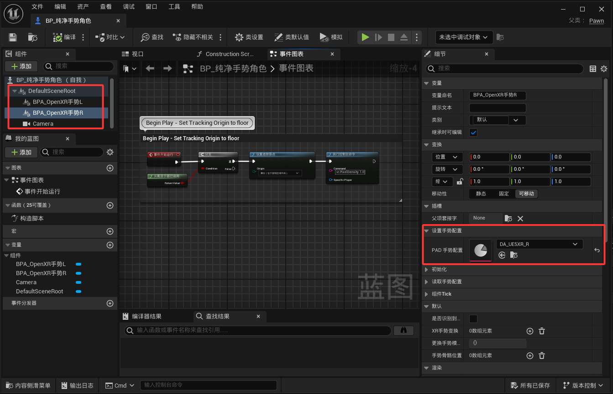
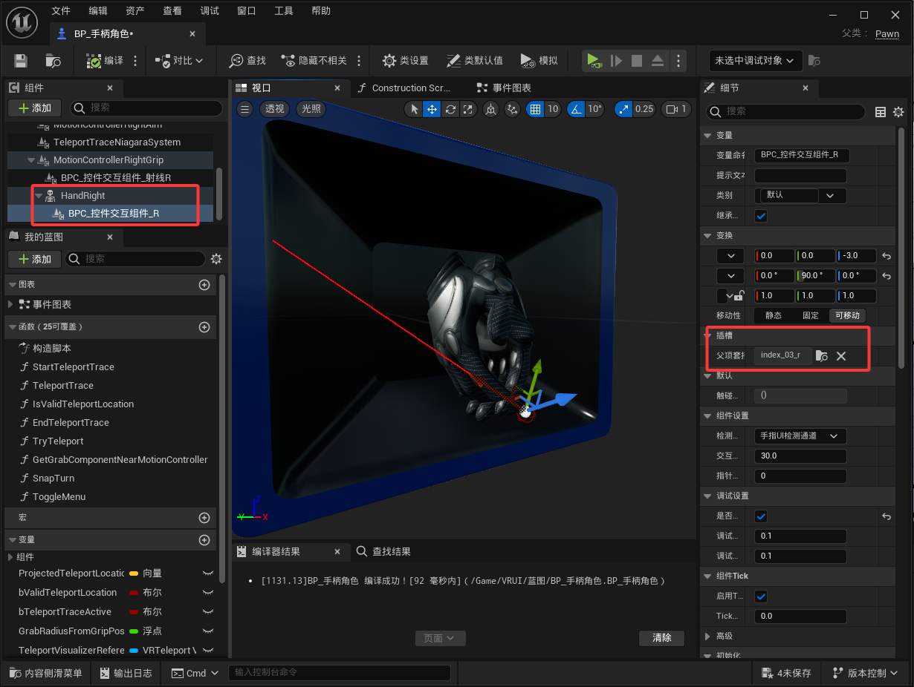
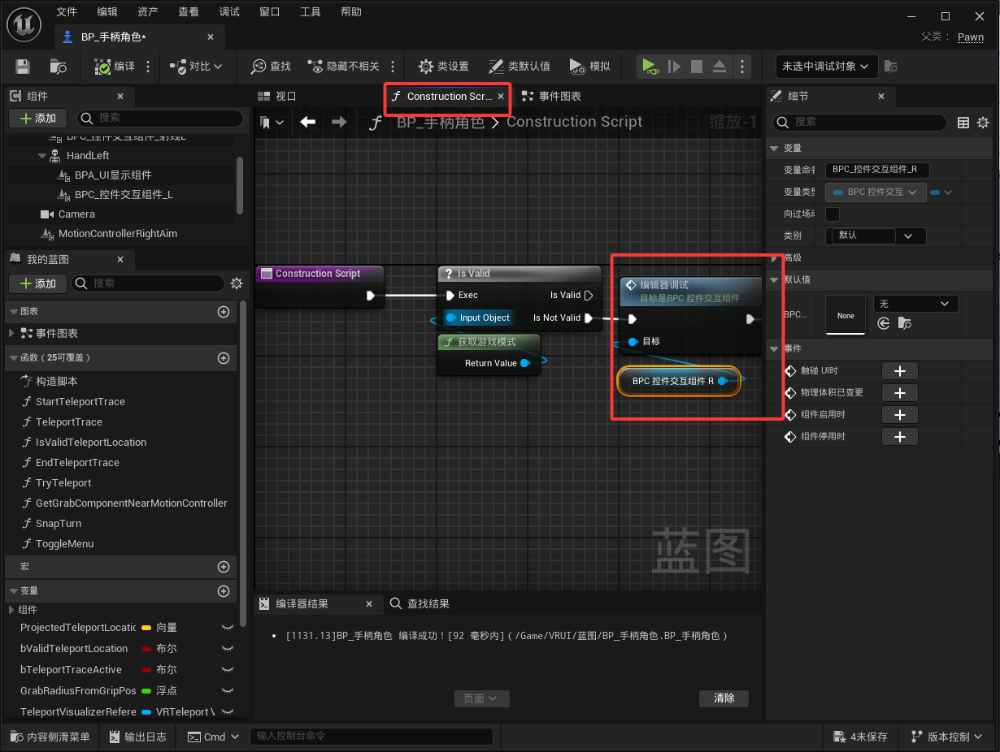
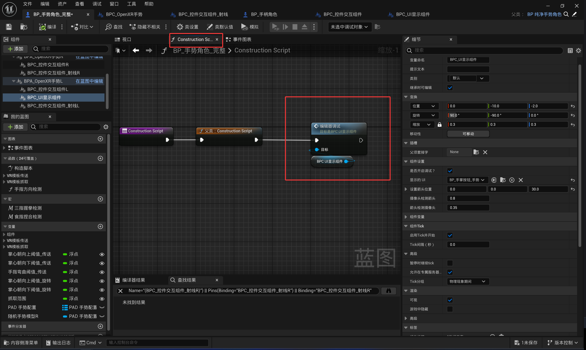

<!-- DOCBLOCK id="review-38" type="text" -->
<!-- ZH -->

<!-- EN -->
Setting Up AC_OpenXRGesture
<!-- /DOCBLOCK -->

<!-- DOCBLOCK id="review-39-original" type="text" -->
<!-- ZH -->
极致简化手势配置流程
现在只需要添加一个手势组件，设置对应左右手的数据资产即可正常运行。
<!-- EN -->
Simplified hand-tracking setup
Add a single gesture component and assign the data asset for the corresponding left or right hand to run the setup.
<!-- /DOCBLOCK -->

<!-- DOCBLOCK id="review-40" type="text" -->
<!-- ZH -->
配置 BPC_控件交互组件
<!-- EN -->
Setting Up AC_WidgetInteraction
<!-- /DOCBLOCK -->

<!-- DOCBLOCK id="review-image-p1792150504802-b1791987675801" type="image" -->

<!-- /DOCBLOCK -->

<!-- DOCBLOCK id="pmvcjr6syn44kns0" type="text" -->
<!-- ZH -->

<!-- EN -->

<!-- /DOCBLOCK -->

<!-- DOCBLOCK id="review-41-original" type="text" -->
<!-- ZH -->
手势角色：添加到BPC_OpenXR手势组件下
手柄角色：添加到角色手部骨骼网格体的食指骨骼上
<!-- EN -->
Hand-tracking character: attach the component to AC_OpenXRGesture.
Controller character: attach the component to the index-finger bone of the character's hand Skeletal Mesh.
<!-- /DOCBLOCK -->

<!-- DOCBLOCK id="review-image-p1792150504802-pmvbnn04ad3hdi63" type="image" -->

<!-- /DOCBLOCK -->

<!-- DOCBLOCK id="review-42" type="text" -->
<!-- ZH -->
如需在蓝图视口预览，在构造脚本中调用组件对应的 编辑器调试 节点，并开启细节面板中的调试设置。
<!-- EN -->
To preview the component in the Blueprint viewport, call its OnEditorDebug node in the Construction Script and enable the debug options in the Details panel.
<!-- /DOCBLOCK -->

<!-- DOCBLOCK id="review-image-p1792150504802-pmvbnoo80qphjb0d" type="image" -->

<!-- /DOCBLOCK -->

<!-- DOCBLOCK id="pmvck817myln66d6" type="text" -->
<!-- ZH -->

<!-- EN -->

<!-- /DOCBLOCK -->

<!-- DOCBLOCK id="review-43" type="text" -->
<!-- ZH -->
配置 BPC_控件交互组件_射线
<!-- EN -->
Setting Up AC_WidgetInteraction_Ray
<!-- /DOCBLOCK -->

<!-- DOCBLOCK id="review-44" type="text" -->
<!-- ZH -->
- 手势角色：将组件添加到 BPC_OpenXR手势 下。
- 手柄角色：将组件添加到 运动控制器组件 下。
<!-- EN -->
- Hand-tracking character: attach the component to AC_OpenXRGesture.
- Controller character: attach the component to the Motion Controller Component.
<!-- /DOCBLOCK -->

<!-- DOCBLOCK id="review-45-original" type="text" -->
<!-- ZH -->
BPC_控件交互组件_射线，需要绑定一个输入，用于触发鼠标左键按压，布尔控制按下左键和松开左键
<!-- EN -->
Bind an input to AC_WidgetInteraction_Ray to simulate the left mouse button. Use a Boolean value to control pressing and releasing the button.
<!-- /DOCBLOCK -->

<!-- DOCBLOCK id="review-image-p1792150504802-pmvb0tv6x69uso4n" type="image" -->

<!-- /DOCBLOCK -->

<!-- DOCBLOCK id="pmvck8udjhgxbj6q" type="text" -->
<!-- ZH -->

<!-- EN -->

<!-- /DOCBLOCK -->

<!-- DOCBLOCK id="review-46" type="text" -->
<!-- ZH -->
配置 BPC_UI显示组件
<!-- EN -->
Setting Up AC_UIDisplay
<!-- /DOCBLOCK -->

<!-- DOCBLOCK id="review-47-original" type="text" -->
<!-- ZH -->
添加你的需要显示UI Actor
在构造脚本，拖出BPC_UI显示组件，连接编辑器调试节点，可在编辑器里观察设置位置（手势模式不太好定位，需要运行时预览效果）
设置箭头位置，箭头是触发器，看向箭头才会触发UI,一般箭头位置在掌心
<!-- EN -->
Assign the Actor containing the UI you want to display.
In the Construction Script, drag out AC_UIDisplay and connect its OnEditorDebug node to preview the configured position in the editor. Positioning is harder in hand-tracking mode, so preview the result at runtime.
Set ArrowLocation. The arrow acts as the trigger reference: looking toward it triggers the UI. It is usually placed at the palm.
<!-- /DOCBLOCK -->

<!-- DOCBLOCK id="review-image-p1792150504802-pmvb0gwgs1282nbp" type="image" -->

<!-- /DOCBLOCK -->

<!-- DOCBLOCK id="pmvcjr28x8j15koi" type="text" -->
<!-- ZH -->

<!-- EN -->

<!-- /DOCBLOCK -->
