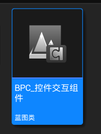
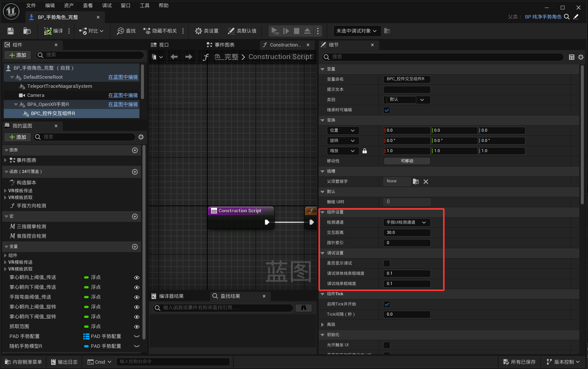

<!-- DOCBLOCK id="page-title-p-component-widget-interaction" type="text" -->
<!-- ZH -->
BPC_控件交互组件
<!-- EN -->
AC_WidgetInteraction
<!-- /DOCBLOCK -->

<!-- DOCBLOCK id="review-75" type="text" -->
<!-- ZH -->
组件设置
<!-- EN -->
Component Settings
<!-- /DOCBLOCK -->

<!-- DOCBLOCK id="review-76" type="text" -->
<!-- ZH -->
检测通道（枚举）
指定 UI 检测使用的碰撞通道，目标 UI 的碰撞响应需要与它对应。
<!-- EN -->
TraceChannel (Enum)
Specifies the collision channel used to detect UI. The target UI's collision responses must match this channel.
<!-- /DOCBLOCK -->

<!-- DOCBLOCK id="review-77" type="text" -->
<!-- ZH -->
交互距离（浮点）
设置手指触碰 UI 的有效检测距离。超出有效距离时不触发该交互。
<!-- EN -->
InteractionDistance (Float)
Sets the effective detection distance for touching UI with a finger. This interaction does not trigger beyond that distance.
<!-- /DOCBLOCK -->

<!-- DOCBLOCK id="review-78" type="text" -->
<!-- ZH -->
指针索引（整数）
设置当前交互指针的编号，用于区分不同的交互指针，组件类别做了编号命名重叠的机制，会获取角色所有控件交互组件自动排序。
<!-- EN -->
PointerIndex (Integer)
Sets the interaction pointer's index to distinguish it from other pointers. The component includes a mechanism to avoid duplicate indices: it gathers all widget interaction components on the character and orders them automatically.
<!-- /DOCBLOCK -->

<!-- DOCBLOCK id="review-79" type="text" -->
<!-- ZH -->
调试设置
<!-- EN -->
Debug Settings
<!-- /DOCBLOCK -->

<!-- DOCBLOCK id="review-80" type="text" -->
<!-- ZH -->
是否显示调试（布尔）
显示交互调试辅助信息，便于检查指尖位置和检测方向。
<!-- EN -->
bShowDebug (Boolean)
Shows interaction debug information to help check the fingertip position and detection direction.
<!-- /DOCBLOCK -->

<!-- DOCBLOCK id="review-81" type="text" -->
<!-- ZH -->
调试球体线条粗细度（浮点）
设置调试球体的线条粗细。
<!-- EN -->
DebugSphereLineThickness (Float)
Sets the line thickness of the debug sphere.
<!-- /DOCBLOCK -->

<!-- DOCBLOCK id="review-82" type="text" -->
<!-- ZH -->
调试线条粗细度（浮点）
设置交互检测调试线的粗细。
<!-- EN -->
DebugLineThickness (Float)
Sets the line thickness of the interaction trace debug lines.
<!-- /DOCBLOCK -->

<!-- DOCBLOCK id="pmvcmeqgeap4j2a3" type="image" -->

<!-- /DOCBLOCK -->

<!-- DOCBLOCK id="pmvcmf836i1zteu4" type="image" -->

<!-- /DOCBLOCK -->

<!-- DOCBLOCK id="pmvcmf837xtk2kwv" type="text" -->
<!-- ZH -->

<!-- EN -->

<!-- /DOCBLOCK -->
