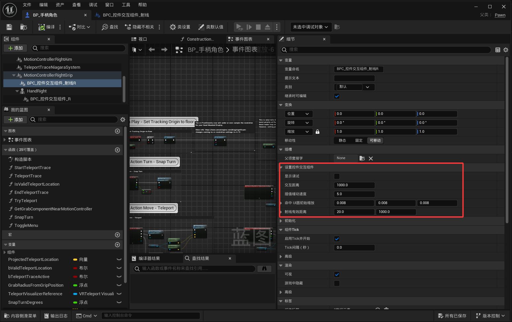
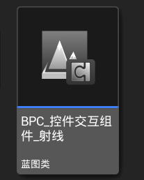
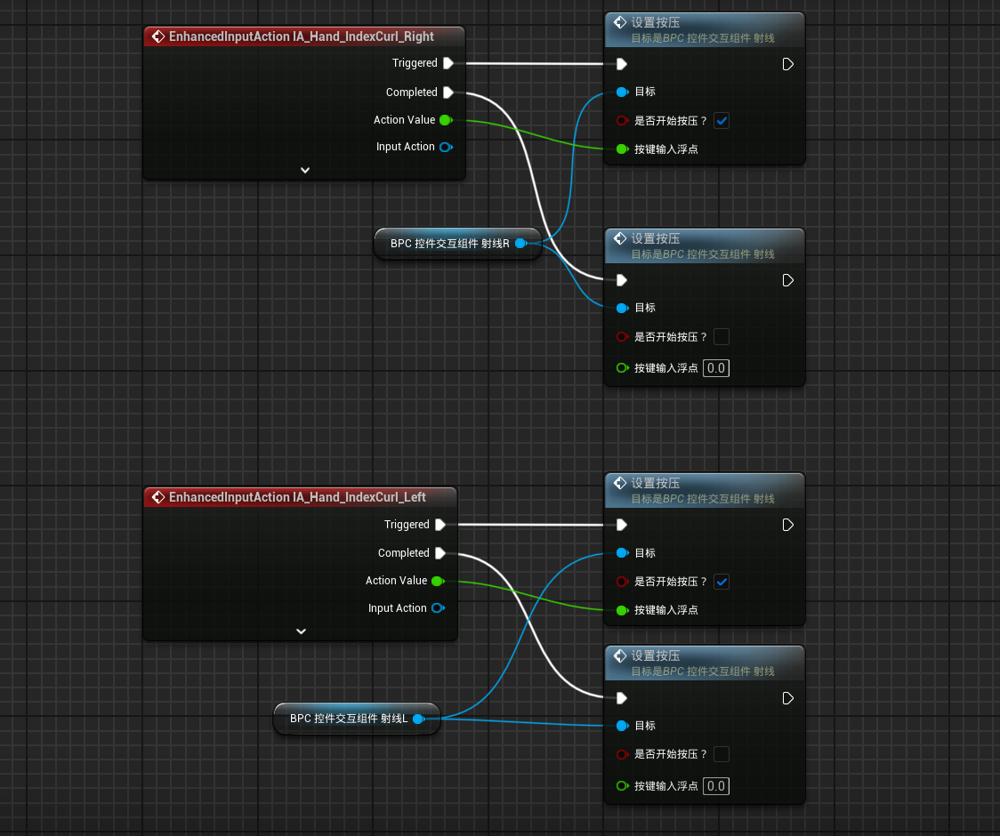

<!-- DOCBLOCK id="review-86" type="text" -->
<!-- ZH -->
设置控件交互组件
<!-- EN -->
Widget Interaction Settings
<!-- /DOCBLOCK -->

<!-- DOCBLOCK id="review-87" type="text" -->
<!-- ZH -->
显示调试（布尔）
显示射线交互调试信息，便于检查检测结果与命中位置。
<!-- EN -->
bShowDebug (Boolean)
Shows ray interaction debug information to help inspect detection results and hit locations.
<!-- /DOCBLOCK -->

<!-- DOCBLOCK id="review-88" type="text" -->
<!-- ZH -->
交互距离（浮点）
设置控件交互检测使用的距离上限
<!-- EN -->
InteractionDistance (Float)
Sets the maximum distance used for widget interaction detection.
<!-- /DOCBLOCK -->

<!-- DOCBLOCK id="review-89" type="text" -->
<!-- ZH -->
插值缓动速度（浮点）
调整射线跟随手部或控制器时的插值响应，数值增大对应更快跟随还是更明显延迟
<!-- EN -->
InterpolationSpeed (Float)
Adjusts interpolation as the ray follows the hand or controller. The source description leaves open whether increasing the value produces faster following or a more noticeable delay.
<!-- /DOCBLOCK -->

<!-- DOCBLOCK id="review-90" type="text" -->
<!-- ZH -->
命中 UI圆初始缩放（向量）
设置射线命中 UI 时，UMG 圆形指示标记的初始缩放。
<!-- EN -->
HitUICircleInitialScale (Vector)
Sets the initial scale of the UMG circular indicator when the ray hits UI.
<!-- /DOCBLOCK -->

<!-- DOCBLOCK id="review-91" type="text" -->
<!-- ZH -->
射线有效距离（二维向量）
设置射线响应 UI 的最短和最远有效距离。(x最短距离，y最远距离）
<!-- EN -->
RayValidDistance (Vector2D)
Sets the minimum and maximum distances at which the ray responds to UI: X is the minimum distance, and Y is the maximum distance.
<!-- /DOCBLOCK -->

<!-- DOCBLOCK id="pmvcm8uuul7m9ynw" type="image" -->

<!-- /DOCBLOCK -->

<!-- DOCBLOCK id="review-92" type="text" -->
<!-- ZH -->
手柄输入
<!-- EN -->
Controller Input
<!-- /DOCBLOCK -->

<!-- DOCBLOCK id="pmvcm8w1451zj0ly" type="text" -->
<!-- ZH -->

<!-- EN -->

<!-- /DOCBLOCK -->

<!-- DOCBLOCK id="pmvcm7kysbnxyps2" type="image" -->

<!-- /DOCBLOCK -->

<!-- DOCBLOCK id="review-93" type="text" -->
<!-- ZH -->
手柄角色注意，需要绑定一个输入，用于触发鼠标左键按压，布尔控制按下左键和松开左键
<!-- EN -->
For a controller character, bind an input to simulate the left mouse button. Use a Boolean value to control pressing and releasing the button.
<!-- /DOCBLOCK -->

<!-- DOCBLOCK id="review-image-p1792150504802-pmvb0tv6x69uso4n" type="image" -->

<!-- /DOCBLOCK -->

<!-- DOCBLOCK id="pmvcm0551j2wvoyd" type="text" -->
<!-- ZH -->

<!-- EN -->

<!-- /DOCBLOCK -->
