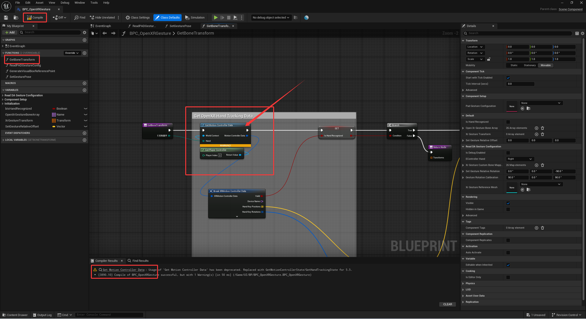
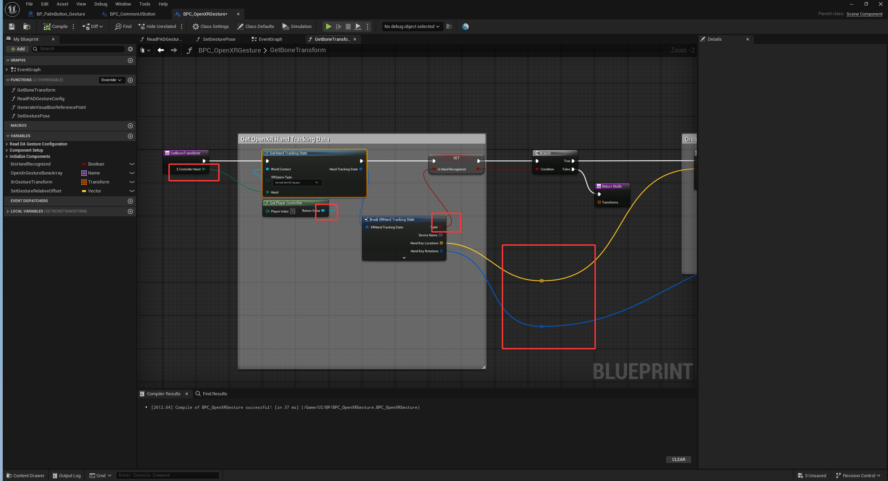

<!-- DOCBLOCK id="review-121-original" type="text" -->
<!-- ZH -->
建议使用UE5.66及以上版本开发，由于虚幻引擎VR模板版本更迭的原因，VR模板变更，节点被弃用。
如果你使用低版本的项目5.3导入高版本例如5.5/5.7，BPC_OpenXR手势会报错，5.3的节点被启用
<!-- EN -->
The source recommends UE 5.66 or later for development. Changes between Unreal Engine VR Template versions have replaced template content and deprecated nodes.
When a project made in an older version such as 5.3 is migrated to a newer version such as 5.5 or 5.7, AC_OpenXRGesture may report errors involving nodes from 5.3.
<!-- /DOCBLOCK -->

<!-- DOCBLOCK id="review-image-p1792158073395-b1769110669099" type="image" -->

<!-- /DOCBLOCK -->

<!-- DOCBLOCK id="review-122" type="text" -->
<!-- ZH -->
1. 打开 BPC_OpenXR手势，定位编译错误所在的手部追踪节点。
2. 原文给出的修复方案是改用 GetHandTrackingState，并重新连接报错引脚。
3. 完成后编译蓝图，运行项目，检查左右手数据、骨骼姿态和 UI 交互。
<!-- EN -->
1. Open AC_OpenXRGesture and locate the hand-tracking nodes causing compilation errors.
2. The original documentation recommends switching to GetHandTrackingState and reconnecting the affected pins.
3. Compile the Blueprint, run the project, and check left- and right-hand data, bone poses, and UI interaction.
<!-- /DOCBLOCK -->

<!-- DOCBLOCK id="review-image-p1792158073395-b1769111406051" type="image" -->

<!-- /DOCBLOCK -->

<!-- DOCBLOCK id="pmvcm53ctg80885t" type="text" -->
<!-- ZH -->

<!-- EN -->

<!-- /DOCBLOCK -->
