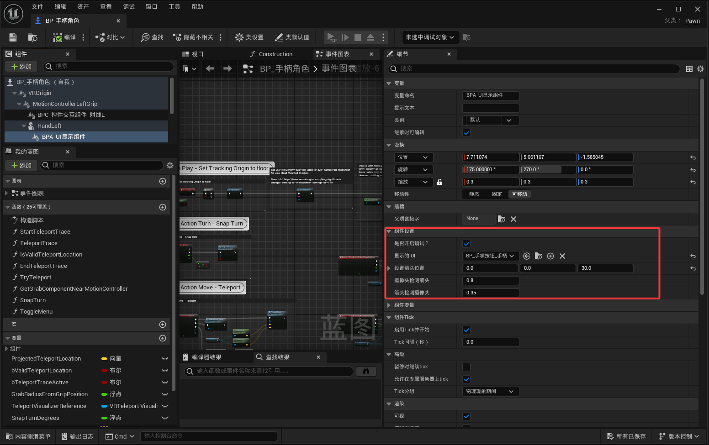
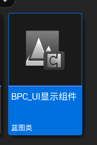

<!-- DOCBLOCK id="page-title-p-component-ui-display" type="text" -->
<!-- ZH -->
BPC_UI显示组件
<!-- EN -->
AC_UIDisplay
<!-- /DOCBLOCK -->

<!-- DOCBLOCK id="review-96" type="text" -->
<!-- ZH -->
组件设置
<!-- EN -->
Component Settings
<!-- /DOCBLOCK -->

<!-- DOCBLOCK id="review-97" type="text" -->
<!-- ZH -->
是否开启调试？（布尔）
显示位置与朝向调试信息，便于调整 UI 显示位置和检测方向。
<!-- EN -->
bIsDebugEnabled (Boolean)
Shows position and orientation debug information to help adjust the UI display position and detection direction.
<!-- /DOCBLOCK -->

<!-- DOCBLOCK id="review-98" type="text" -->
<!-- ZH -->
显示的UI（Actor 类）
指定包含目标 UI 的 Actor 蓝图类，而不是直接选择 UMG 控件类。
<!-- EN -->
DisplayedUIClass (Actor Class)
Specifies the Actor Blueprint class containing the target UI. Select the Actor class rather than a UMG widget class directly.
<!-- /DOCBLOCK -->

<!-- DOCBLOCK id="review-99" type="text" -->
<!-- ZH -->
设置箭头位置（变换）
设置显示检测参考箭头的相对变换。箭头作为检测参考，通常放在掌心附近；
<!-- EN -->
ArrowLocation (Transform)
Sets the relative transform of the reference arrow used for display detection. The arrow acts as the detection reference and is usually placed near the palm.
<!-- /DOCBLOCK -->

<!-- DOCBLOCK id="review-100" type="text" -->
<!-- ZH -->
摄像头检测箭头（浮点）
设置摄像头朝向参考箭头的检测阈值。
<!-- EN -->
CameraToArrowCheck (Float)
Sets the detection threshold for the camera facing the reference arrow.
<!-- /DOCBLOCK -->

<!-- DOCBLOCK id="review-101" type="text" -->
<!-- ZH -->
箭头检测摄像头（浮点）
设置参考箭头朝向摄像头的检测阈值。
<!-- EN -->
ArrowToCameraCheck (Float)
Sets the detection threshold for the reference arrow facing the camera.
<!-- /DOCBLOCK -->

<!-- DOCBLOCK id="pmvcmbhvvvr8hd3q" type="image" -->

<!-- /DOCBLOCK -->

<!-- DOCBLOCK id="pmvcmcsh26i40v7e" type="text" -->
<!-- ZH -->

<!-- EN -->

<!-- /DOCBLOCK -->

<!-- DOCBLOCK id="pmvcmcls2jvzrcqg" type="image" -->

<!-- /DOCBLOCK -->

<!-- DOCBLOCK id="pmvcmcls4eod9vz4" type="text" -->
<!-- ZH -->

<!-- EN -->

<!-- /DOCBLOCK -->
