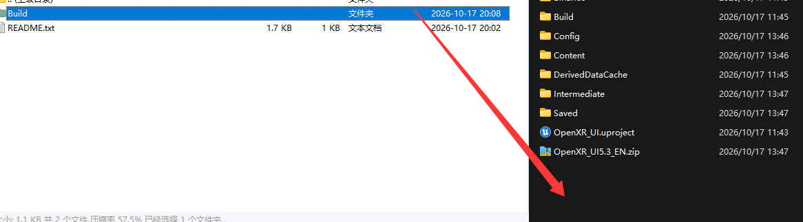
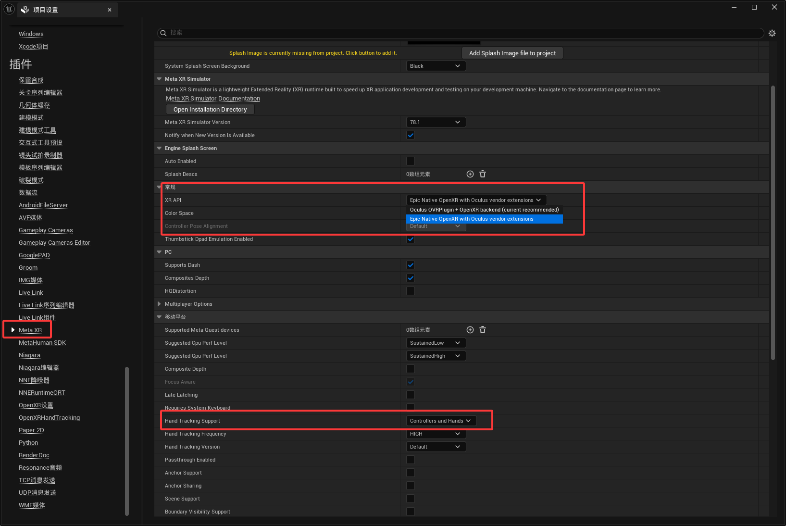

<!-- DOCBLOCK id="review-25" type="text" -->
<!-- ZH -->
Quest 注意事项
<!-- EN -->
Quest Notes
<!-- /DOCBLOCK -->

<!-- DOCBLOCK id="review-26" type="text" -->
<!-- ZH -->
使用早于 UE 5.6 的版本打包 Quest Android 应用后，可能出现手部追踪失效。
<!-- EN -->
Hand tracking may fail in Quest Android builds made with UE versions earlier than 5.6.
<!-- /DOCBLOCK -->

<!-- DOCBLOCK id="review-27" type="text" -->
<!-- ZH -->
处理方法一：下载补充文件的 ZIP 压缩包，将其中的 Build 文件夹解压到项目根目录，再重新打包。
https://drive.google.com/drive/folders/1sM8ENQs16vU-sUkuhrR8MW-gbacvxulv?usp=drive_link
<!-- EN -->
Workaround 1: download the supplementary ZIP archive, extract its Build folder into the project root, and package the project again.
https://drive.google.com/drive/folders/1sM8ENQs16vU-sUkuhrR8MW-gbacvxulv?usp=drive_link
<!-- /DOCBLOCK -->

<!-- DOCBLOCK id="review-image-p1769101542580-pmvcctrhp0jpzwo9" type="image" -->

<!-- /DOCBLOCK -->

<!-- DOCBLOCK id="review-30" type="text" -->
<!-- ZH -->
处理方法二：启用 MetaXR，并在项目设置中检查以下配置：
<!-- EN -->
Workaround 2: enable MetaXR and check the following options in Project Settings:
<!-- /DOCBLOCK -->

<!-- DOCBLOCK id="review-31" type="text" -->
<!-- ZH -->
1. XR API：Epic Native OpenXR with Oculus vendor extensions。
2. Hand Tracking Support：Controllers and Hands。
<!-- EN -->
1. XR API: Epic Native OpenXR with Oculus vendor extensions.
2. Hand Tracking Support: Controllers and Hands.
<!-- /DOCBLOCK -->

<!-- DOCBLOCK id="review-32" type="text" -->
<!-- ZH -->
MetaXR 下载：
<!-- EN -->
Download MetaXR:
<!-- /DOCBLOCK -->

<!-- DOCBLOCK id="review-33" type="text" -->
<!-- ZH -->
https://developers.meta.com/horizon/downloads/package/unreal-engine-5-integration/
<!-- EN -->
https://developers.meta.com/horizon/downloads/package/unreal-engine-5-integration/
<!-- /DOCBLOCK -->

<!-- DOCBLOCK id="review-image-p1769101542580-b1769773154230" type="image" -->

<!-- /DOCBLOCK -->

<!-- DOCBLOCK id="pmwr6nndk7ihb1nv" type="text" -->
<!-- ZH -->

<!-- EN -->

<!-- /DOCBLOCK -->
