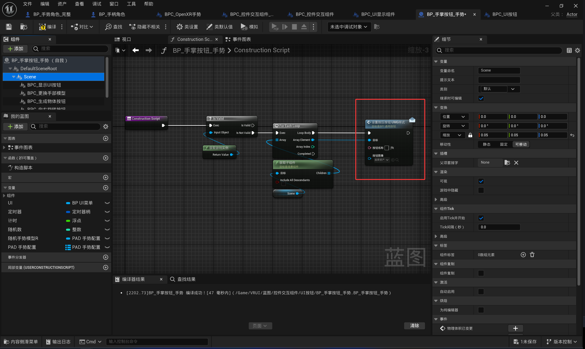
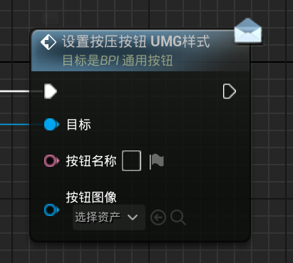

<!-- DOCBLOCK id="page-title-p-component-ui-button" type="text" -->
<!-- ZH -->
BPC_UI按钮
<!-- EN -->
AC_UIButton
<!-- /DOCBLOCK -->

<!-- DOCBLOCK id="review-104" type="text" -->
<!-- ZH -->
控件设置
<!-- EN -->
Widget Settings
<!-- /DOCBLOCK -->

<!-- DOCBLOCK id="review-105" type="text" -->
<!-- ZH -->
按钮名称（文本）
设置按钮显示的文字。
<!-- EN -->
ButtonName (Text)
Sets the text displayed on the button.
<!-- /DOCBLOCK -->

<!-- DOCBLOCK id="review-106" type="text" -->
<!-- ZH -->
按钮图像（二维纹理）
设置按钮显示的图像纹理。
<!-- EN -->
ButtonImage (Texture2D)
Sets the image texture displayed on the button.
<!-- /DOCBLOCK -->

<!-- DOCBLOCK id="review-107" type="text" -->
<!-- ZH -->
最小按压距离（x轴）（浮点）
设置按钮沿组件局部 X 轴触发按压所需的距离阈值，用于调整触发深度。
<!-- EN -->
MinPressDistanceX (Float)
Sets the distance threshold along the component's local X axis required to trigger a press, allowing you to adjust the activation depth.
<!-- /DOCBLOCK -->

<!-- DOCBLOCK id="review-111" type="text" -->
<!-- ZH -->
设置按钮样式
<!-- EN -->
Setting the Button Style
<!-- /DOCBLOCK -->

<!-- DOCBLOCK id="review-112" type="text" -->
<!-- ZH -->
运行时需要调用“设置按压按钮UMG样式”节点。如果还需要在蓝图视口预览按钮 UI，可在构造脚本中调用同一节点。
<!-- EN -->
Call SetPressButtonUMGStyle at runtime. To also preview the button UI in the Blueprint viewport, call the same node in the Construction Script.
<!-- /DOCBLOCK -->

<!-- DOCBLOCK id="review-image-p-component-ui-button-pmvb1zzofl302xb3" type="image" -->

<!-- /DOCBLOCK -->

<!-- DOCBLOCK id="pmvcis3863wti1z6" type="text" -->
<!-- ZH -->

<!-- EN -->

<!-- /DOCBLOCK -->

<!-- DOCBLOCK id="review-image-p-component-ui-button-pmvb20o5rvok4qgs" type="image" -->

<!-- /DOCBLOCK -->

<!-- DOCBLOCK id="pmvcirpmab83c037" type="text" -->
<!-- ZH -->

<!-- EN -->

<!-- /DOCBLOCK -->
