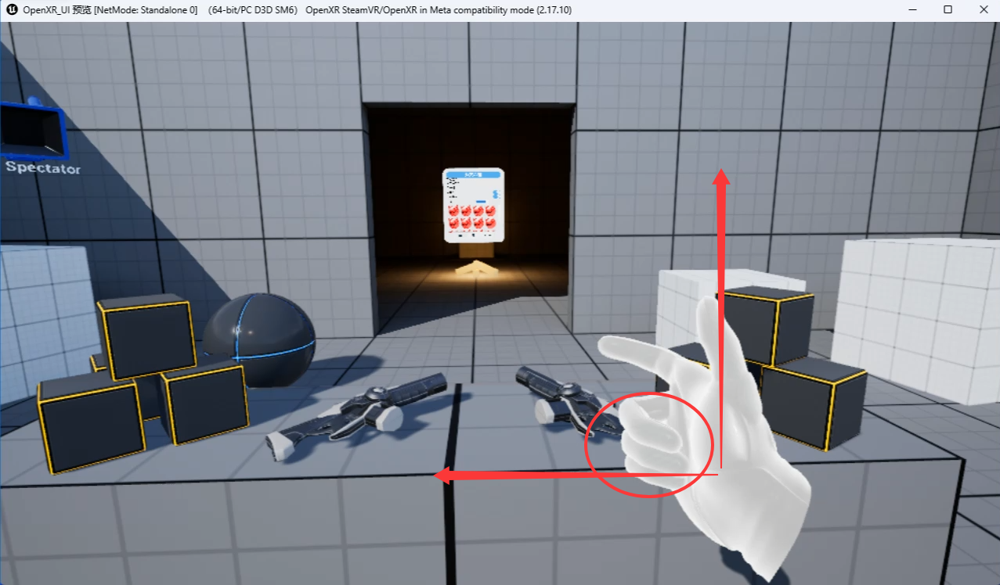
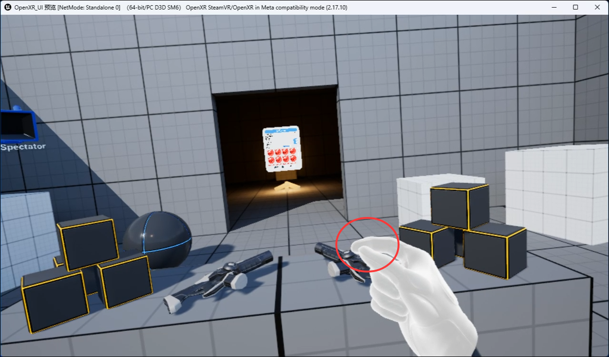
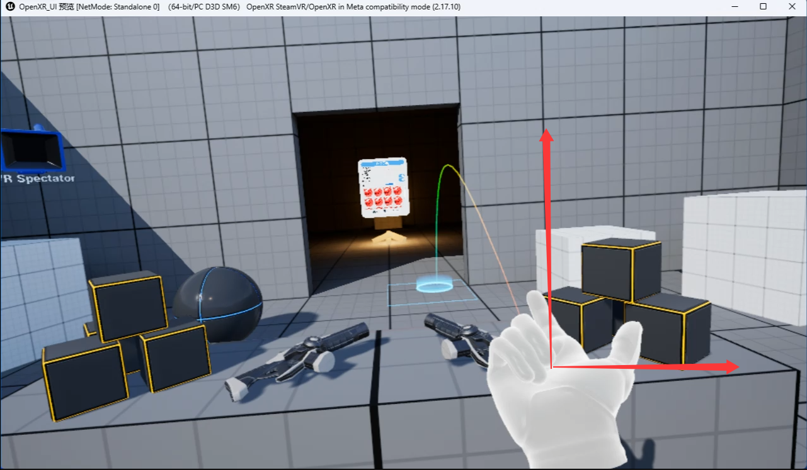

<!-- DOCBLOCK id="pmvb2pzk5bf5xlex" type="text" -->
<!-- ZH -->
手势角色基础操作
<!-- EN -->

<!-- /DOCBLOCK -->

<!-- DOCBLOCK id="pmvbnqz92mv29m8k" type="text" -->
<!-- ZH -->
中指，无名指，小拇指握拳并且手掌向右垂直，进入旋转模式手变成高亮状态
<!-- EN -->

<!-- /DOCBLOCK -->

<!-- DOCBLOCK id="pmvb2p0lkwozoy99" type="image" -->

<!-- /DOCBLOCK -->

<!-- DOCBLOCK id="pmvb380jnr848mz9" type="text" -->
<!-- ZH -->
保持高亮状态，捏合食指和大拇指，触发向右旋转（左手同理）
食指捏合同样作用物体抓取
<!-- EN -->

<!-- /DOCBLOCK -->

<!-- DOCBLOCK id="pmvb380018l3uf37" type="image" -->

<!-- /DOCBLOCK -->

<!-- DOCBLOCK id="pmvb3ai3kedgadin" type="text" -->
<!-- ZH -->
右手中指，无名指，小拇指握拳并且手掌向上时，进入传送模式手变成高亮状态，捏合食指和大拇指，触发向传送移动。
<!-- EN -->

<!-- /DOCBLOCK -->

<!-- DOCBLOCK id="pmvb39wdku67m2nc" type="image" -->

<!-- /DOCBLOCK -->

<!-- DOCBLOCK id="pmvb39wdkfnqwawe" type="text" -->
<!-- ZH -->

<!-- EN -->

<!-- /DOCBLOCK -->
