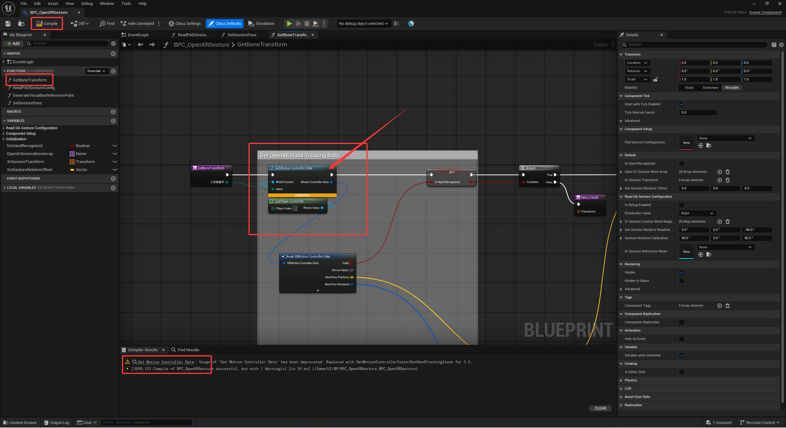
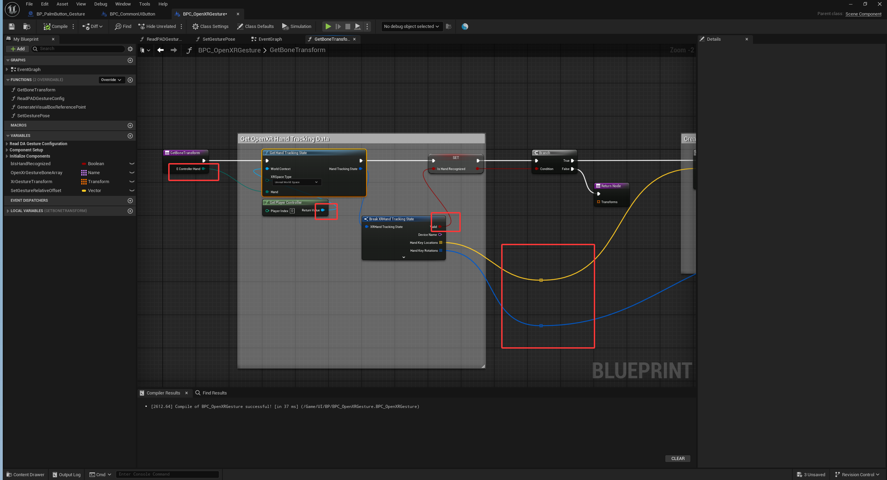

<!-- DOCBLOCK id="page-title-p1792158073395" type="text" -->
<!-- ZH -->
旧版本迁移节点修复
<!-- EN -->
Migrating Older Projects and Fixing Nodes
<!-- /DOCBLOCK -->

<!-- DOCBLOCK id="review-121-original" type="text" -->
<!-- ZH -->
建议使用 UE 5.6 或更高版本进行开发。随 UE 版本变更，VR 模板和部分蓝图节点也会更新。
将 UE 5.3 工程迁移至 UE 5.5 或 5.7 时，旧版手部追踪节点可能导致 BPC_OpenXR手势 编译报错。
<!-- EN -->
UE 5.6 or later is recommended for development. The VR Template and some Blueprint nodes change between Unreal Engine versions.
When migrating a UE 5.3 project to UE 5.5 or 5.7, older hand-tracking nodes may cause compilation errors in AC_OpenXRGesture.
<!-- /DOCBLOCK -->

<!-- DOCBLOCK id="review-image-p1792158073395-b1769110669099" type="image" -->

<!-- /DOCBLOCK -->

<!-- DOCBLOCK id="review-122" type="text" -->
<!-- ZH -->
1. 打开 BPC_OpenXR手势，定位编译报错的手部追踪节点。
2. 将旧的 Get Motion Controller Data 节点替换为 Get Hand Tracking State，再重新连接受影响的引脚。
3. 编译蓝图并运行项目，检查左右手数据、骨骼姿态和 UI 交互。
<!-- EN -->
1. Open AC_OpenXRGesture and locate the hand-tracking node reported by the compiler.
2. Replace Get Motion Controller Data with Get Hand Tracking State and reconnect the affected pins.
3. Compile the Blueprint and run the project to check tracking data for both hands, bone poses, and UI interaction.
<!-- /DOCBLOCK -->

<!-- DOCBLOCK id="review-image-p1792158073395-b1769111406051" type="image" -->

<!-- /DOCBLOCK -->

<!-- DOCBLOCK id="pmvcm53ctg80885t" type="text" -->
<!-- ZH -->

<!-- EN -->

<!-- /DOCBLOCK -->
